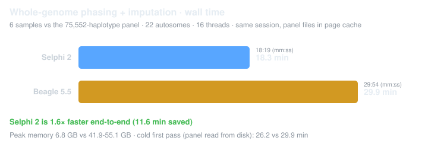
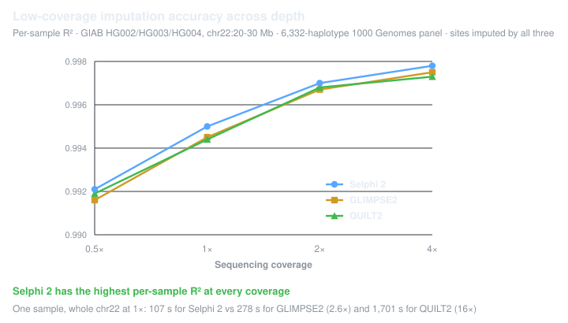

<p>
  <picture>
    <source media="(prefers-color-scheme: dark)" srcset="img/title.svg"/>
    <source media="(prefers-color-scheme: light)" srcset="img/title_light.svg"/>
    
  </picture>
</p>


**Selphi** is a genotype phasing and imputation tool implemented in Rust. It provides a phasing engine (a diploid genotype graph with a segment HMM, used for every input) and two imputation engines: a Li-Stephens PBWT engine for chip/WGS hard calls, and a genotype-likelihood-aware engine for low-coverage WGS (`--lcwgs`). Everything runs in a unified, memory-efficient pipeline. All internal data structures use a bitmatrix representation (1 bit per allele), HMM kernels are SIMD-accelerated (AVX-512/AVX2 on x86, NEON on Apple Silicon), and results are fully deterministic across runs.

<p align="center">
  <picture>
    <source media="(prefers-color-scheme: dark)" srcset="img/pipeline_dark.svg"/>
    <source media="(prefers-color-scheme: light)" srcset="img/pipeline_light.svg"/>
    
  </picture>
</p>

<p align="center">
  <picture>
    <source media="(prefers-color-scheme: dark)" srcset="img/speed_dark.svg"/>
    <source media="(prefers-color-scheme: light)" srcset="img/speed_light.svg"/>
    
  </picture>
</p>

> Methodology, parameters, and full benchmark tables (accuracy, phasing switch-error, speed/memory, and comparisons to Beagle, IMPUTE5, Minimac4, SHAPEIT5, GLIMPSE2 and QUILT2) are in the Selphi 2 manuscript (in preparation). This README is a usage reference.

## Quick start

```bash
# 1. Build (Rust 1.89+)
git clone -b new_version/selphi2_cluster https://github.com/omicsedge/selphi.git && cd selphi
cargo build --release                       # binary: target/release/selphi

# 2. Convert the reference panel once: VCF.gz, BCF or BREF3 -> panel.chr22.srp next to the source
selphi --prepare-reference-from panel.chr22.bcf --threads 16

# 3a. Array or WGS genotypes (VCF/BCF, phased or unphased)
selphi --refpanel panel.chr22.srp --input sample.vcf.gz --map plink.chr22.GRCh38.map \
  --out imputed --threads 16

# 3b. Low-coverage sequencing, straight from aligned reads (a PL VCF works too, via --input)
selphi --bam sample.bam --reference GRCh38.fa --refpanel panel.chr22.srp \
  --map plink.chr22.GRCh38.map --out imputed --threads 16
```

No other flag is needed. Selphi reads the input and picks the engine (array, WGS or low-coverage reads), phases the samples and sets the phasing from the size of the run, and the log says what it chose. The result is `imputed.vcf.gz` with its `.tbi`. Add `--bcf`, `--parquet`, `--pgen` or `--selfdecode` for other formats, `--phase-only` to phase without imputing, and see [Whole-genome imputation](#whole-genome-imputation) to run every chromosome in one command. A genetic map in PLINK format is required ([Genetic maps](#genetic-maps)).

## Contents

- [Quick start](#quick-start)
- [Installation](#installation)
  - [Distribution binaries](#distribution-binaries)
  - [Genetic maps](#genetic-maps)
- [Usage](#usage)
  - [Engine selection (--engine)](#engine-selection---engine)
  - [Full pipeline (phase + impute)](#full-pipeline-phase--impute)
  - [Phased input](#phased-input)
  - [Phase-only](#phase-only)
  - [Allele reconciliation (--allele-match)](#allele-reconciliation---allele-match)
  - [Missing genotypes](#missing-genotypes)
  - [Variant-only and exome VCFs](#variant-only-and-exome-vcfs)
  - [gVCF and all-sites VCFs](#gvcf-and-all-sites-vcfs)
  - [Filtered records](#filtered-records)
  - [Sex chromosomes](#sex-chromosomes)
  - [Panel phasing (de-novo, no reference)](#panel-phasing-de-novo-no-reference)
  - [Whole-genome imputation](#whole-genome-imputation)
  - [Low-coverage WGS (--lcwgs)](#low-coverage-wgs---lcwgs)
  - [Memory-bounded mode (biobank-scale)](#memory-bounded-mode-biobank-scale)
  - [Reference panel preparation](#reference-panel-preparation)
- [Output formats](#output-formats)
  - [Target sites absent from the panel](#target-sites-absent-from-the-panel)
  - [Output fields](#output-fields)
- [Accuracy evaluation](#accuracy-evaluation)
- [Indexing](#indexing)
- [Self-test](#self-test)
- [CLI reference](#cli-reference)
- [How it works](#how-it-works)
- [Citation](#citation)
- [Non-Commercial Use License](#non-commercial-use-license)

## Installation

Requires Rust 1.89+ (edition 2024) and a C compiler (gcc or clang): cargo builds the bundled zstd, bzip2, xz/lzma and mimalloc C sources, so no other development packages are needed. If the system liblzma development files are present, cargo links liblzma dynamically instead, and the binary then needs `liblzma.so.5` at run time.

```bash
git clone -b new_version/selphi2_cluster https://github.com/omicsedge/selphi.git   # the default branch (master) is Selphi 1
cd selphi
cargo build --release
# Binary: target/release/selphi
```

Optionally install to PATH:

```bash
cargo install --path .
```

Selphi builds for Linux x86_64, macOS x86_64, and aarch64 (Apple Silicon / AWS Graviton), one build per platform. x86_64 builds target `x86-64-v3` (AVX2/FMA: Intel Haswell, AMD Zen or newer) and do not start on older CPUs; build with `RUSTFLAGS="-C target-cpu=native"` for another CPU. Within a build, AVX-512 is picked at startup with one cached check, and NEON is used on aarch64; no recompilation. `SELPHI_FORCE_SCALAR=1` forces the scalar path for parity testing, `SELPHI_QUIET_SIMD=1` suppresses the startup line.

### Distribution binaries

`scripts/build-release.sh` produces named binaries in `dist/`:

```bash
./scripts/build-release.sh            # selphi-linux-x86_64           (glibc dynamic)
./scripts/build-release.sh --musl     # also: selphi-linux-x86_64-musl (static)
```

| Binary | When to use | Trade-off |
|---|---|---|
| `selphi-linux-x86_64` | Default. Server / cluster / cloud. | Fast. Needs glibc ≥ 2.39 as built here; rebuild in an older-glibc container (Ubuntu 18.04/20.04, `manylinux2014`) to lower the floor. |
| `selphi-linux-x86_64-musl` | Alpine, Docker `scratch`, very old distros. | Self-contained, no libc dependency; ~60% slower in the HMM hot path. |

The musl build needs `apt install musl-tools` and `rustup target add x86_64-unknown-linux-musl`.

### Genetic maps

Selphi needs a genetic map in PLINK format (cM positions); Beagle maps work directly. One file per chromosome (e.g. `plink.chr22.GRCh38.map`); a genome-wide file also works, as only the run's chromosome is read from it. Positions outside the map are extrapolated at the chromosome's mean rate, in phasing, imputation and the low-coverage engine alike. Recommended: [GRCh38 genetic maps](https://bochet.gcc.biostat.washington.edu/beagle/genetic_maps/).

## Usage

Input is a standard VCF or BCF, phased (`0|1`) or unphased (`0/1`). Selphi phases the input when any sample has a heterozygous call written with `/` (homozygous and haploid calls carry no phase and do not count). An already phased input is phased again too, and its own phase is kept where it agrees with the new one (see [Phased input](#phased-input)). A haploid call (a male's chrX `1`, chrY, MT) is read as the homozygote, as Beagle and `bcftools +fixploidy` do. Windows line endings are accepted. A multi-allelic record is split into one biallelic marker per ALT (the `bcftools norm -m-` convention: each counts its own ALT allele); ALTs the panel lacks are written to the output as split records. When two records match the same panel variant (duplicated probes), the first is kept and the count is logged. A REF/ALT-swapped record is matched to the panel only for substitutions: an insertion and the opposite deletion at one position are different variants. Only target sites that match a panel site are used for phasing and imputation (the log reports `Shared markers: N (x% of target)`); the others are still written to the output, as given (see [Target sites absent from the panel](#target-sites-absent-from-the-panel)).

### Engine selection (`--engine`)

`--engine auto` (the default) sniffs the target and picks the imputation engine: aligned reads or a `PL` VCF route to the low-coverage engine; confident WGS-density calls with a GQ/DP field route to the genotype engine with GL-aware refinement; a chip array or any other GT input, whatever its call rate, routes to the plain genotype engine (the low-coverage engine reads `PL`, not GT). A `PL` file whose calls the reads settle (80% or more with the second-best genotype 20 Phred below the best) goes to the genotype engine instead, reading the call confidence from `PL`, when it lists under half the panel's sites in its span and either carries reference calls or will have its omissions read as reference (an exome, a targeted panel, a variant-only genome; see [Variant-only and exome VCFs](#variant-only-and-exome-vcfs)); on a multi-chromosome panel that rule needs 95% of the calls settled, since the multi-chromosome genotype path writes calls as given. A `GL` field is read as `PL` (`round(-10·GL)`), here and in both engines. A gVCF stays on the low-coverage engine, which reads its reference blocks (see [gVCF and all-sites VCFs](#gvcf-and-all-sites-vcfs)); its settled share is counted on its variant records, not its blocks. `--phase-only` never routes to the low-coverage engine; with aligned reads it is refused. A VCF without GT goes to the low-coverage engine, as does any run given `--reference`. Force a specific engine with `--engine lcwgs | genotype | refine` (the legacy `--lcwgs` and `--refine` flags still work and map onto these; `--engine genotype` is the explicit force-off). Genotype input, chip or WGS, is phased by the diploid genotype-graph engine.

### Full pipeline (phase + impute)

```bash
selphi \
  --refpanel reference.srp \
  --input chip_genotypes.vcf.gz \
  --map genetic_map.map \
  --out imputed \
  --threads 16
```

### Phased input

Imputing on the phase an input arrives with scores below re-phasing it: on 801 1000 Genomes array samples (chromosome 22, 1000 Genomes panel) a Beagle-phased input gives OVERALL R² 0.4796 imputed on its phase (`--keep-input-phase`) and 0.4895 re-phased with `--force-phasing` (0.4899 from a SHAPEIT5-phased input), which phases such a cohort as two copies per sample like an unphased input. Keeping a good given phase as one phase-ensemble member, with the re-phased chain's solution as the other, scores about the same on this cohort (0.4896 Beagle-phased, 0.4898 SHAPEIT5-phased with `--trust-input-phase`; chromosome 1 +0.0089 over the given phase, 801 of 801 samples up), whereas a poor one lowers the result (Beagle's phase with 10% extra switches: 0.4655; a random phase: 0.4051). The default below, which keeps the given phase per sample, scores 0.4889 on the Beagle-phased input: above imputing on the given phase, 0.0006 below `--force-phasing` on this 801-sample cohort. So, by default, a phased input is re-phased and each sample is judged on its own: its given phase stays as ensemble member 0 when at most 5% of its consecutive heterozygous pairs at the panel sites have a different relative phase in the new solution (`SELPHI_INPUT_PHASE_GATE`, default 0.05; Beagle or SHAPEIT5 phase against Selphi's: 4.0%, 95th percentile 6.3%; another Selphi seed: 3.0%); otherwise the sample gets the re-phased chain's two members (its Viterbi solution and an MCMC sample). A sample with fewer than 50 such pairs keeps its phase. The log reports how many samples kept their phase and the median disagreement. A kept sample's output genotypes keep the orientation of its input heterozygotes, and its no-calls are filled as an unphased input's are.

- `--keep-input-phase`: impute on the given phase, without phasing (faster; for comparisons that must share one phase).
- `--trust-input-phase`: keep the given phase for every sample, whatever its disagreement.
- `--force-phasing`: re-phase and do not use the given phase.

A phased input under the default or `--trust-input-phase` is not given the phasing replicas an unphased run of up to 1,000 samples gets (see [How it works](#how-it-works)): its members stay its given phase and the re-phased solution, or the re-phased solution's two. Under `--force-phasing` it is phased like an unphased input, replicas included. An input with no heterozygous call at the panel sites (a man's chromosome X imputed on its own) has no phase to keep or re-estimate and is not phased, unless `--force-phasing`. With `--sample-batch-size` there is one member: a sample that keeps its phase is imputed on it (as with `--keep-input-phase`), one that does not on the re-phased solution.

### Phase-only

```bash
selphi \
  --refpanel reference.srp \
  --input wgs_genotypes.vcf.gz \
  --map genetic_map.map \
  --out phased \
  --phase-only
```

Phase-only needs a single-chromosome `.srp` (a multi-chromosome SRP or `--refpanel-dir` is refused). With `--phase-only` an already phased input is left as it is (nothing is written) unless you add `--force-phasing`. Whether the input is phased is decided on the records that match the panel: records absent from the panel are written back as given and never phased, so an unphased heterozygote there (as a phase-only output carries) does not trigger re-phasing. The order in which an unphased call lists its alleles (`1/0` or `0/1`) carries no information and does not affect the result.

With `SELPHI_DIPLOID_PQ=1` (experimental) the phase-only VCF also carries `FORMAT/PQ` at each heterozygote the segment HMM phased: the phred-scaled posterior probability (an integer, capped at 60) that its phase relative to the previous heterozygote of the sample is wrong, read from the posteriors the MCMC already stores. It ranks pairs well (54 trio children: AUC 0.96 on array sites, 0.95 at WGS density; the lowest tenth of PQ values holds 88% of array switch errors) and is calibrated below PQ 7, but overstates confidence above it (PQ 13-19 means about 8% errors, not 3%), so read it as a ranking more than as an exact probability.

### Long-range phase check for two-continent ancestry

One person phased alone against a large panel carries long-range orientation errors: stretches of megabases where the two haplotypes are swapped against the rest of the chromosome. For someone whose parents come from two continents the panel shows them: window by window each haplotype is closest to one continental group of the panel's 1000 Genomes samples, and an inversion makes the two haplotypes trade groups. By default (`SELPHI_ANC_POST=apply`) Selphi reads that signal after phasing and undoes the inversions in the phased solution before imputation (`report` only logs what it would do; `off` restores the previous output exactly). Per sample and chromosome it scores 60-site windows against an equal number of AFR, EAS, EUR and SAS panel haplotypes (1000 Genomes superpopulations from an embedded table; the admixed AMR, ASW and ACB samples are never labels), runs a Viterbi over the group of each haplotype and the orientation with a flip prior from the solution's phase quality, and applies the path only to a two-continent reading: one pair of different groups over at least 70% of the windows (`SELPHI_ANC_PAIR_FRAC`), a likelihood at least 0.4 per window above the best one-group reading (`SELPHI_ANC_LR_MIN`), and at most 0.04 group changes per window (`SELPHI_ANC_CHANGE_RATE_MAX`; a child of two continents keeps its two groups, an old admixture trades them). Each change is placed at the heterozygote that best splits the two groups' allele frequencies and has the lowest phase quality. At sequencing density the windows use one common panel SNP per 5 kb and the change is placed among all heterozygotes.

Measured on chromosome 22 against the 75,552-haplotype production panel with the targets' families and relatives removed, one sample at a time: synthetic children of two continents (one haplotype from each of two 1000 Genomes samples, exact truth) keep 1.1 orientation changes of 1 Mb or longer per chromosome instead of 5.7-6.3 and 0.15-0.17 of 5 Mb or longer instead of 1.3, with switch error 0.15-0.17 percentage points lower; 54 real trio children (alone and jointly), 60 synthetic same-population and 66 within-continent children are left exactly as phased, and so are 921 of 925 HGDP people (the 4 are Middle Eastern, North African and Central Asian samples whose old African-European or European-South Asian admixture reads as two groups). At sequencing density (1.07 million sites, 1000 Genomes panel) the same synthetic children keep 2.8 long changes instead of 8.5 and the 54 real children are unchanged. Imputed against the full production panel with exact truth, 120 held-out children of two continents gain 0.0008 per-sample R² (75 of 120 up; African-mixed pairs +0.001 to +0.002) and 66 children of two populations of one continent are unchanged, as are six consumer-array genomes and the 801-sample 1000 Genomes cohort. Mixes within a continent are not detected. The check needs the panel at the array sites, so `--phase-only` runs it only within `SELPHI_PHASE_ONLY_RARE_REF_GB`.

### Allele reconciliation (`--allele-match`)

Target sites are matched to the panel, and by default REF/ALT-swapped sites are reconciled (a chip that labels REF/ALT opposite the panel would otherwise silently lose those markers). Choose the level:

```bash
selphi ... --allele-match full        # none | swap (default) | strand | full
```

- `none`: exact REF/ALT only (no reconciliation)
- `swap` (default): also accept REF/ALT-swapped sites (recodes the genotype to panel orientation) — unambiguous
- `strand`: also accept opposite-strand SNPs (reverse-complement, with or without a REF/ALT swap), but not plain same-strand swaps, so it loses the sites `swap` reconciles
- `full`: swap + strand

`strand`/`full` carry a small false-match risk on non-palindromic SNPs (a target variant absent from the panel can reverse-complement onto a different one), so they stay opt-in. Palindromic SNPs (A/T, C/G) are matched by exact equality only. Sites that already match exactly are never touched, so conforming input is bit-identical regardless of mode. The number of reconciled sites is reported in the log.

### Missing genotypes

No-call genotypes in the target (`./.`, common on genotyping arrays at ~1–2% of sites per sample, and at every site of a batch that another sample's array typed) carry no information, and Selphi treats them as absent. A site that no sample called is imputed as an untyped panel site, so a single user's no-call gives exactly the result of leaving the record out. Where only some samples are missing, the diploid phasing keeps the no-call missing and imputes it with the segment HMM at every MCMC iteration, as SHAPEIT5 does (the phased output carries that imputed allele at common sites and the nearest PBWT neighbours' majority at rare ones; `SELPHI_DIPLOID_NOCALL_OBSERVED=1` restores entering the neighbours' majority as an observed genotype, which cost 0.004 imputation R² on an 801-sample array cohort with 2% no-calls), while the imputation of each sample that misses the site runs its candidate selection, PBWT and Li-Stephens HMM over the sites that sample called and places its copying weights at the no-call by cM-linear interpolation between its called sites on either side — the dosages it would get if the record were left out for it, so imputing users together gives each of them what imputing them one at a time gives. The output at such a typed site is the imputed dosage for the samples that are missing it, and their exact call for the others.

### Variant-only and exome VCFs

A VCF that lists only the sites where the sample carries an ALT allele, the usual WGS or exome deliverable, leaves out its reference homozygotes. Imputing those sites as if they were missing costs accuracy and calls ALT alleles the sample does not carry: on HG002 at 30× (chromosome 22, 4,478-haplotype panel) a variant-only file scores per-sample R² 0.9806 with 1,526 false ALT calls, against 0.9970 and 133 for the same calls with the reference homozygotes written out. Selphi therefore reads the panel sites such a file leaves out as reference homozygotes:

- **automatically**, for one sample with at least 1,000 ALT calls, reference calls (0/0 records, or ALT `.` records below all-sites density) up to 0.5% of them, 300 or more records per Mb and a median FORMAT/DP of 8 or more (without DP, a median GQ of 20 or more; a GT-only file is taken as the standard-depth genome such a deliverable is), along the span of its records (a stretch of more than 100 kb without a record is left to imputation). The HG002 file then scores 0.9969 with 132 false ALT calls; at 10× (median DP 10) filling still raises R² from 0.9737 to 0.9764 (false ALT calls 1,852 to 116).
- **with `--callable regions.bed`**, inside the given regions for every sample: an exome's capture targets, or the callable regions of a genome. An HG003 exome (IDT capture) scores 0.973 inside its targets against 0.917 without.

It does not at positions the file lists with any allele or covers with a deletion, at no-call records, inside a structural variant's END/SVLEN span, at panel positions holding two records, for indels when the file has none, below the depth gate (at 4× a caller leaves out 25% of the true ALT sites), when a quarter or less of the file's records match the panel (a file on another genome build), or when the added sites would make the chromosome's panel matrix exceed 4 GB (`SELPHI_VARIANT_ONLY_REF_GB`; a 75,552-haplotype panel needs 9.4 KB per site). Each case is logged. The sites read as reference are written as 0/0 calls flagged `IMP`, so they can be told apart from the input's own calls. `SELPHI_VARIANT_ONLY_FILL=0` turns the automatic reading off. On chrX the sex test leaves the sites read as reference out, so a woman's heterozygosity is measured on her own calls, and a man, whose variant-only calls are a few percent heterozygous (HG002 30×: DeepVariant 4.0%, bcftools 9.4%, against 57-59% for HG001), is one X below 25% of them. On a 1000 Genomes chrX panel without HG001 and her parents, per-sample R² went from 0.9515 to 0.9694 (HG002, DeepVariant), 0.7956 to 0.8110 (HG002, bcftools diploid calls), 0.9781 to 0.9836 (HG001, DeepVariant) and 0.9763 to 0.9818 (HG001, DRAGEN), with fewer false ALT calls in each; HG002 held diploid scores 0.9689. `SELPHI_VARIANT_ONLY_CHRX=0` keeps chrX imputed. The sites read as reference are homozygous, so they carry no phase: when the file's own calls are a genome's (300 or more per Mb), they are left out of the phasing scaffold (HG002 chrX: phasing 200 → 23 s, the run 7:55 → 4:51; per-sample R² unchanged within seed-to-seed variation on chromosomes 22 and X); an exome keeps them, its few heterozygotes being phased better with them (HG003 chromosome 22 with `--callable`: 0.8134 against 0.8077). `SELPHI_FILL_HMM_MAF=0.05` also leaves those below that panel frequency out of the imputation model (still written as 0/0): five times faster again (chromosome 22: 71-74 → 15 s, 6.8-8.3 → 1.6-1.8 GB) at a per-sample R² cost of 0.00004-0.00009 for HG001 over three seeds (HG002 unchanged), so it is not the default. For an exome the BAM is better still when it exists: its off-target reads give the low-coverage engine the rest of the genome (HG003 chromosome 22 outside the targets: R² 0.902 from the BAM against 0.808 from the VCF with `--callable`).

### gVCF and all-sites VCFs

A gVCF or an all-sites VCF writes its reference calls itself: reference blocks (`<NON_REF>`, `<*>` or `<X>` ALTs, or ALT `.` with an END, as `bcftools call --gvcf` writes them) and ALT `.` records, one per site. Selphi reads them as the sample's calls, not as missing data:

- **likelihood files** (`PL`) stay on the low-coverage engine, which gives each panel SNP inside a block the block's likelihoods (its `PL` for the placeholder allele; for a GT:DP block, the depth of its reference reads at a 1% base error), splits multi-allelic and `X,<NON_REF>` records into one site per ALT with that ALT's `PL` subset, and reads a VCF and its BCF copy identically. HG002 chromosome 22 from `bcftools mpileup | bcftools call -m --gvcf 20`, scored at the panel's sites: per-sample R² 0.9975 at 30× and 0.9959 at 10×, against 0.9794 and 0.9772 with the blocks read as missing and 0.9972 and 0.9910 for the genotype engine reading them as reference calls.
- **on the genotype engine** (a file without `PL`, `--engine genotype`/`refine`, `--phase-only`), the panel sites inside the file's good-quality reference calls are read as 0/0 calls flagged `IMP`: GQ, else RGQ, else the gap between the two best `PL`, of 20 or more; FORMAT/DP of 10 or more when that is the only field. No-call and low-quality blocks, structural variants over their END/SVLEN span and spanning deletions keep their positions from being read as reference, and a check of the calls' REF bases against the panel's catches a file on another build. An all-sites HG002 30× file at the panel's sites scores 0.997030, as the same calls written as 0/0 records do (0.997049; 0.981 before, when its ALT `.` records were dropped and written back).
- ALT `.` records count as calls only on a chromosome with 5,000 or more records per Mb, so an array exported with ALT `.` at its monomorphic sites is read as before; on such a chromosome they are not written back to the output (they were 869,567 of 1.8 million output records on chromosome 22), nor are reference blocks, ever.

### Filtered records

A record whose FILTER is set and is not `PASS` is one its caller rejected. By default (`--input-filter auto`) Selphi keeps the record's position but reads its calls as no-calls: the site is imputed for that sample, the variant-only reading above never takes the position as reference, and a record the panel lacks is written back with no-calls. The low-coverage engine reads a filtered record's likelihoods as given, since it weighs each by its own values. DeepVariant writes the candidates it rejects as `RefCall` records with 0/0 and `./.` calls; read as calls, those 0/0 records also keep a variant-only file from being recognised as one. On its raw 30× output for chromosome 22 (73,778 and 75,985 `RefCall` records), HG001 scores per-sample R² 0.98983 when they are read as calls and 0.99637 when they are not (false ALT calls 1,075 → 484); HG002 scores 0.98290 → 0.99636 (1,914 → 487). A DRAGEN HG001 file with 689 filtered records goes from 0.99811 to 0.99871 (346 → 297). `--input-filter keep` reads every record as given, as Beagle, SHAPEIT5 and GLIMPSE2 do; `--input-filter missing` also gives the low-coverage engine flat likelihoods at filtered records (the DRAGEN file on that engine: 0.98995 → 0.98980, within noise).

### Sex chromosomes

- **chrX**: when Selphi phases the target (unless `--keep-input-phase` on a phased input), males are auto-detected (low heterozygosity outside the pseudo-autosomal regions) and treated as diploid inside PAR1/PAR2 and haploid elsewhere: their PAR heterozygous calls are kept, their non-PAR het calls (genotyping errors) are reset before phasing. PAR coordinates follow `--build` (`grch38`, `grch37`, or `auto`, the default, inferred from the panel). `--chrx-no-par` treats males as haploid over the whole chromosome. Male chrX genotypes and dosages are written diploid; a phased input imputed with `--keep-input-phase` is used as is. Give chrX its whole genetic map: the PLINK GRCh38/37 maps put PAR1 and PAR2 in their own files. With `--map plink.chrX.GRCh38.map` the `plink.chrX_par1`/`_par2` files beside it are joined automatically (the log says so), as they are under `--map-dir`; `--map a,b,c` joins any list of files in position order, each continuing the previous one's cM. Without the PAR files, PAR1's ~21 cM would be extrapolated from the end of the non-PAR map and imputation there suffers. Some arrays report a man's whole chrX, PARs included, as single letters, which normalisation turns into homozygous calls although about half of them are heterozygous: a male with no heterozygous call among at least 50 called PAR sites has those calls entered with low confidence (`SELPHI_PAR_COLLAPSED_CONF`, default 0.1), so the copying model leans on the panel there while the calls themselves are written as given (PAR1 imputed SNP R² 0.60-0.65 → 0.68-0.72 on three such men; a man with real PAR heterozygotes is never selected). A male imputed on his own has no heterozygous non-PAR call; his calls at sites common in the panel still form the phasing scaffold (every called site when none is).
- **chrY / chrMT**: refused, because the Li-Stephens recombination model does not apply to a non-recombining / haploid contig and standard panels omit them. In whole-genome runs they are skipped with a warning. `SELPHI_ALLOW_NONRECOMB=1` forces a run.

### Panel phasing (de-novo, no reference)

Phase an unphased cohort using the cohort itself as the conditioning set (SHAPEIT5/Beagle-style reference-panel construction), in one command:

```bash
# --input: VCF.gz, .srp, or .bref3 (re-phase an existing panel)
# --srp / --bref3: also emit native .srp / .bref3 reference panels
selphi --phase-panel \
  --input cohort.vcf.gz \
  --map genetic_map.map \
  --out panel \
  --srp --bref3 \
  --threads 16

# Phase one region only (the whole input is still read first)
selphi --phase-panel --input cohort.vcf.gz --map map.map --out panel --region 22:16000000-20000000
```

Output is always `panel.vcf.gz`; `--srp`/`--bref3` additionally emit native reference panels (the `.srp` is directly usable as `--refpanel`). Cohorts too large for the memory budget are split into overlapping chunks of a fixed number of variants, sized from available RAM, and ligated; `--chunk-vars N` sets the variants per chunk. For biobank scale pass an indexed BCF (`.bcf` + `.csi`): at 16,000 samples or more it is streamed chunk by chunk with bounded memory (`--region` turns streaming off). Missing genotypes are imputed during phasing (see Missing genotypes). On chromosome X the diploid engine treats men as haploid outside PAR1/PAR2, as the imputation path does: men are read from `--haploids` or recognised by fewer than 1% heterozygous calls outside the PARs (over the whole cohort; a streamed cohort takes them from `--haploids` only), their heterozygous calls there are reset as genotyping errors, and their missing genotypes there are imputed as one allele on both haplotypes (`--chrx-no-par` makes them haploid over the whole chromosome).

### Whole-genome imputation

A single multi-chromosome SRP file imputes the entire genome in one command (no per-chromosome splitting or shell loops):

```bash
selphi \
  --refpanel all_chromosomes.srp \
  --input whole_genome.vcf.gz \
  --map all_chromosomes.map \
  --out imputed \
  --threads 16
```

Single- vs multi-chromosome SRP is auto-detected. Chromosomes are processed sequentially, with the next one's data prefetched in the background. Target chromosomes absent from the panel (chrY, MT, unplaced contigs) are written as given after the panel's chromosomes, with their own `##contig` lines, like unmatched sites on a panel chromosome (`--drop-unmatched` leaves them out). Every imputed chromosome must have a map (`--map` concatenated, or `--map-dir`), or Selphi errors out early. The multi-chromosome path writes VCF.gz or BCF only (`--parquet`, `--pgen`, `--selfdecode`, `--all-formats` and `--phase-only` are refused; run per chromosome for those) and does not apply GL-aware refinement.

### Low-coverage WGS (`--lcwgs`)

For low-coverage sequencing (uniform 0.5-4× genomes, or capture libraries with a low-pass off-target background), where most sites carry a genotype likelihood rather than a confident call, use the genotype-likelihood-aware engine. Input is a VCF/BCF with the `PL` field (e.g. from `bcftools mpileup | bcftools call`) at the panel's sites. Only input sites whose REF/ALT match the panel exactly are imputed and written (this engine does not carry the other input records through); a record without `PL` counts as a flat-likelihood site:

```bash
selphi --lcwgs \
  --refpanel reference.srp \
  --input target_gl.vcf.gz \
  --map genetic_map.map \
  --out imputed \
  --threads 16
```

Output is `GT:DS:GP`. Panel SNP sites between a `PL` file's first and last record that it does not list are imputed from flat likelihoods, as `bcftools call -i` would write them (a file that lists them all is unaffected). On chrX, males are haploid outside PAR1/PAR2: they are taken from haploid calls in the input (two-value `PL`, as `bcftools call --ploidy` writes), from `--haploids`, or recognised from their genotype likelihoods (a man shows reads of both alleles outside the PARs only through read errors). There each of a man's two sampled haplotypes is drawn from his one allele's read likelihood, independently of the other, and his genotype posteriors are haploid (no heterozygote). The engine alternates sparse-PBWT haplotype selection with a GL-weighted Li-Stephens forward-backward (a conditional-HL diploid Gibbs sampler) and an eight-founder phasing HMM re-committed at every iteration (`LCWGS_NO_FOUNDER_PHASE=1` reverts to the older diplotype-mosaic segment commitment), processing the chromosome in cM chunks so the full panel is never held in memory. The selected set is capped per sample at `LCWGS_KPBWT` haplotypes (unset: 6.6% of the panel, clamped to 2,000-5,000, so 2,000 on panels below about 30,000 haplotypes); with the default storage-site spacing the union of PBWT neighbours across a chunk covers nearly the whole panel and the cap, applied in haplotype-index order, keeps an almost fixed low-index subset, so the target-specific part of the conditioning set is the per-haplotype rare-carrier augmentation (`LCWGS_SEL_DIAG=1` prints the pre-cap union size). `LCWGS_QUAL_TRUNC=1` (or `g2`, GLIMPSE2's order) caps by PBWT match rank instead: it lifts the 0.5× ultra-rare bin above GLIMPSE2 but lowers other bins and 1× accuracy, so it is opt-in. The forward-backward is SIMD-accelerated and √n-checkpointed (bit-identical, ~2× faster and ~10× lower peak memory). Against GLIMPSE2 and QUILT2 on GIAB genomes downsampled to 0.5-4×, Selphi has the highest overall per-sample R² at every depth, with the three tools within 0.0006 of one another; below 0.5% MAF it trails GLIMPSE2 at 0.5×, is level at 1× and leads at 2× and 4×, and in the other frequency bins no tool leads throughout. On one sample it is 1.2× faster than GLIMPSE2 on a capture library (26 against 32 s, chromosome 22, 16 threads) and about as fast on a whole chromosome 22 at ~1.8× (33-35 against 31.5 s; QUILT2 128 s), and 2.0× faster on six capture libraries in one run (77.5 against 156.6 s). Full MAF-binned and multi-coverage numbers are in the manuscript. Expert knobs are exposed via `LCWGS_*` environment variables; defaults are calibrated for 1× data.

<p align="center">
  <picture>
    <source media="(prefers-color-scheme: dark)" srcset="img/lcwgs_dark.svg"/>
    <source media="(prefers-color-scheme: light)" srcset="img/lcwgs_light.svg"/>
    
  </picture>
</p>

#### Native BAM/CRAM input

Point `--lcwgs` directly at aligned reads and Selphi computes the genotype likelihoods natively at the panel's sites (no `bcftools mpileup`); with `--bam` the default `--engine auto` picks this engine on its own, so `--lcwgs` is optional. One file per sample; `--bam-list` takes a file with one path per line. CRAM also needs the reference FASTA (with a `.fai`):

```bash
# Single BAM
selphi --lcwgs --bam sample.bam --reference GRCh38.fa --refpanel reference.srp --map genetic_map.map --out imputed --threads 16

# CRAM (needs the reference FASTA used at compression)
selphi --lcwgs --bam sample.cram --reference GRCh38.fa --refpanel reference.srp --map genetic_map.map --out imputed --threads 16

# Many samples, bounded to a region (with a <file>.bai / <file>.crai index only that region is decoded)
selphi --lcwgs --bam-list bams.txt --reference GRCh38.fa --refpanel reference.srp --map genetic_map.map \
  --region chr20:1000000-2000000 --out imputed --threads 16

# Whole genome: a multi-chromosome panel (or --refpanel-dir) runs every chromosome the reads or the PL file cover
selphi --bam sample.bam --reference GRCh38.fa --refpanel all_chrs.srp --map-dir maps/ --out imputed --threads 16
```

On a multi-chromosome panel each chromosome runs as its own single-chromosome run (one VCF.gz and one dosage TSV, chromosomes in panel order; each chromosome's records are those of the run made with that chromosome's panel alone, checked on NA24143 chromosomes 20 and 22); a chromosome the input does not cover is left out, and chrY/MT are skipped. `--map` may be one file holding every chromosome, or `--map-dir` a directory of per-chromosome maps. A whole-genome BAM or CRAM with an index is read one chromosome at a time through it.

The pileup is CIGAR-aware and applies the standard mapping/base-quality filters (`LCWGS_MIN_MAPQ`, `LCWGS_MIN_BQ`, `LCWGS_MAX_DEPTH`), collapsing overlapping paired-end mates per site; its GLs use the `bcftools mpileup` error model at the same filters but are not identical by default (supplementary alignments are dropped, and mates are merged per site rather than by htslib's overlap reconciliation, which `LCWGS_OVERLAP_HTSLIB=1` reproduces). Contig names are matched tolerant to the `chr` prefix.

**Pass `--reference` for BAM input too.** With the reference FASTA available, Selphi applies Base Alignment Quality (BAQ) as `bcftools mpileup` does by default: extended BAQ (a re-alignment HMM that caps the quality of bases whose placement near an indel or soft clip is uncertain) on the reads bcftools' partial-realignment heuristic selects. The port is bit-identical to htslib/bcftools 1.22 (verified against `samtools calmd -r -E` on 28,596 reads). Without `--reference` BAQ cannot run and the pileup uses raw base qualities, which costs accuracy at low coverage (chr22, six GIAB capture libraries: +0.162 instead of +0.198 percentage points of non-reference concordance over GLIMPSE2). `LCWGS_NO_BAQ=1` disables it (bcftools `-B`); `LCWGS_FULL_BAQ=1` realigns every read (bcftools `-D`, slightly worse than the partial default).

**Speed profile.** The sampler runs 30 iterations by default (5 burn-in, then 25 whose dosages are averaged). On the six capture libraries (chromosome 22, 16 threads), one sample takes about 26 s, 210 CPU-seconds and 2.6 GiB (all 16 threads work on that sample's forward-backward blocks as they become ready, which costs CPU time: 130 CPU-seconds per sample when six share a run); GLIMPSE2 with its 16 phase chunks run concurrently takes about 32 s, 320 CPU-seconds and 13.7 GiB. With six and twelve samples per run Selphi takes 78 and 126 s against GLIMPSE2's 157 and 302 s. Chunks and samples are scheduled under a memory budget (`LCWGS_MEM_BUDGET_GB`, default half the machine's RAM).

Indel panel sites carry no read evidence on the default path, so they are left out of the imputation target set and are not written: BAM input yields SNP dosages by default. `LCWGS_BAM_KEEP_INDELS=1` keeps them with a flat prior, the previous behaviour (within noise on the capture libraries: +0.184 against +0.190 percentage points over GLIMPSE2); `LCWGS_INDEL_REALIGN=1` (needs `--reference`) scores them from the reads with a pair-HMM realignment instead.

### Memory-bounded mode (biobank-scale)

For panels where memory is the binding constraint, `--sample-batch-size N` processes target samples in batches of N. Peak memory scales with the batch size, at ~30-40% wall overhead. Batching turns off the two-member phase ensemble (as `SELPHI_DIPLOID_INTRA_N=1`) and the phasing replicas, so dosages differ slightly from a non-batched run; with `--keep-input-phase` a phased input's output equals the non-batched run's. Per-batch intermediates go to `$TMPDIR` (default `/tmp`); point it at a volume with room.

```bash
selphi \
  --refpanel topmed.srp \
  --input cohort.vcf.gz \
  --map genetic_map.map \
  --out imputed \
  --bcf \
  --sample-batch-size 100 \
  --threads 16
```

Supported for all output formats, which can be combined (e.g. `--bcf --parquet --pgen --sample-batch-size 100`); each format has its own per-batch writer and native sample-merger.

A WGS-density genotype input (hundreds of thousands of called sites per chromosome) is imputed in windows of at most 100,000 typed sites (`SELPHI_WINDOW_MAX_MARKERS`), because a window's copying weights are held for every typed site until it is interpolated. One 30× sample on chromosome 22 (918,000 called sites, 4,478-haplotype panel) peaks at 6.7 GB in these windows, against 51 GB in 80-cM windows, with the same R².

### Reference panel preparation

Create an SRP reference panel from VCF, BCF, or BREF3 (source format auto-detected). The `.srp` is written next to the source by default (`panel.bcf` → `panel.srp`).

```bash
# From BCF (fastest: parallel native BCF reader, 16 threads)
selphi --prepare-reference-from panel.bcf --threads 16

# From VCF.gz / BREF3
selphi --prepare-reference-from panel.vcf.gz
selphi --prepare-reference-from panel.bref3

# Explicit output path + custom chunk size
selphi --prepare-reference-from panel.bcf --out custom_name.srp --chunk-size 10000
```

| Source | Index required | Notes |
|---|---|---|
| `.bcf` | `.bcf.csi` | Parallel regional reads via CSI index; multi-contig supported; constant (<500 MB) memory. |
| `.bref3` | none | Native BREF3 reader (ported from Java). |
| `.vcf.gz` | none | Streamed line by line (single chromosome) into an in-memory phased panel, then scattered to the SRP; peak memory scales with the panel. For whole-genome / very large panels prefer `.bcf` (streaming, constant memory). |

All three sources give the same panel and the same imputed dosages (the `.srp` files differ only in header `##contig` lines and chunk layout). For whole-genome panels, build a single multi-chromosome SRP from a directory of per-chr files, or merge existing per-chr SRPs:

```bash
selphi --prepare-reference-from /path/to/bcfs/ --out all_chromosomes --threads 16   # directory of per-chr BCFs
selphi --merge-srps-dir /path/to/srps/ --out all_chromosomes                        # merge per-chr SRPs
```

Variants with an allele of 255 bytes or more (structural-variant alleles) are kept: the variant index stores their lengths escaped, and such a panel carries a distinct format signature, so Selphi builds that predate long-allele support refuse it rather than misread it; a panel without long alleles is written exactly as before.

#### Decode a panel back to VCF / BCF

A `.bref3` or `.srp` panel can be decoded straight to phased VCF.gz or BCF — a fast,
multithreaded native replacement for Beagle's `unbref3` (no Java, no external converter).
The direction is selected by the output extension: a `.bref3`/`.srp` source with a
`.vcf.gz` or `.bcf` output decodes instead of building a panel.

```bash
selphi --prepare-reference-from panel.bref3 --out panel.bcf    --threads 16   # BREF3 → BCF (fastest)
selphi --prepare-reference-from panel.bref3 --out panel.vcf.gz --threads 16   # BREF3 → VCF.gz
selphi --prepare-reference-from panel.srp   --out panel.bcf    --threads 16   # SRP   → BCF
```

The decoder streams one bounded batch at a time and runs as a three-stage pipeline (panel
read → per-record formatting → BGZF compression), so peak memory stays below 1.5 GB
regardless of panel length, and the output is coordinate-sorted, phased, and indexed
(`.csi`/`.tbi`). On a 75,552-haplotype panel (37,776 samples × 2.58 M chr21 variants) BREF3 → BCF
runs in ≈2.8 min (BREF3 → VCF.gz ≈6 min); an SRP → BCF → SRP → BCF round trip reproduces the genotype matrix exactly.

## Output formats

Selphi supports five output formats. Formats are additive: combine any flags to produce multiple outputs in a single pass (interpolation runs once, encoding fans out to all active formats). `--bcf` replaces VCF; the rest are additive. `--all-formats` enables VCF + Parquet + PGEN + SelfDecode. A run whose output would be one of its input files (the same path, or a symlink to it) is refused before anything is written. Parquet, PGEN and SelfDecode are single-chromosome only, and the low-coverage engine always writes `<out>.vcf.gz` (`GT:DS:GP`, INFO `AF`, panel contig spelling and variant IDs, with its `.tbi`) plus `<out>.dose.tsv.gz` and ignores these flags.

| Flag | Format | Content | Best for |
|---|---|---|---|
| *(default)* | VCF.gz | GT, DS, AP1, AP2 per sample | Standard bioinformatics, bcftools |
| `--bcf` | BCF 2.2 | GT, DS, AP1, AP2 per sample | Fast downstream parsing, no external deps |
| `--parquet` | Apache Parquet (zstd) | DS per sample, variant-major | Data science, Polars/DuckDB |
| `--pgen` | PLINK2 PGEN | Hardcall (2-bit) + dosage (16-bit) | GWAS with plink2 |
| `--selfdecode` | ZIP of per-sample Parquet | GT, AP1, AP2 per sample | SelfDecode ETL pipeline |

```bash
selphi --refpanel ref.srp --input input.vcf.gz --map map.map --out result               # VCF.gz (default)
selphi --refpanel ref.srp --input input.vcf.gz --map map.map --out result --bcf          # native BCF (replaces VCF)
selphi --refpanel ref.srp --input input.vcf.gz --map map.map --out result --bcf --parquet --selfdecode
selphi --refpanel ref.srp --input input.vcf.gz --map map.map --out result --all-formats
```

Dosages are identical across formats up to each format's precision (VCF `DS` is rounded to three decimals, PGEN stores steps of 1/16384, BCF/Parquet/SelfDecode store 32-bit floats). Hardcalls differ by design: PGEN rounds the summed dosage (the PLINK convention), while VCF/BCF/SelfDecode GT use a per-haplotype argmax; they agree on confident calls and can differ only on borderline per-hap probabilities (chip sites never).

### Target sites absent from the panel

A target record whose `(POS, REF, ALT)` matches no panel site cannot be phased against the panel or imputed, but it is part of the input, so by default Selphi writes it to the output at its position, exactly as given: ID, REF, every ALT, and each sample's GT with its allele indexes, separator (`/` or `|`) and ploidy. QUAL, FILTER and INFO are `.`, which sets these records apart from the panel sites (FILTER `PASS`) and leaves the output header unchanged. The log says how many there were. `--drop-unmatched` leaves them out, as Beagle and most imputation tools do.

This holds for whole-genome runs, `--phase-only` and `--sample-batch-size`. VCF, BCF and SelfDecode carry every such record; Parquet and PGEN, which hold one ALT dosage per row, carry the biallelic ones (DS = the ALT allele count, missing for a no-call). The records are read in a second pass over the target, limited to the run's chromosome through its `.tbi`/`.csi` index when there is one; a matched site is recognised from its position and alleles without decoding its genotypes, so the pass costs little.

### Output fields

Imputed sites from the genotype (chip/WGS) engine carry the following fields (VCF/BCF):

| Field | Scope | Description |
|---|---|---|
| `DR2` | INFO | Dosage R-squared: estimated per-variant imputation accuracy (0.0-1.0), Beagle's per-haplotype estimator, defined for a single sample (where it is 1 at a confident heterozygote and 0 at a homozygote) |
| `AF` | INFO | Alternate allele frequency |
| `AC` | INFO | Alternate allele count |
| `AN` | INFO | Total allele number |
| `IMP` | INFO | Flag: a site absent from the input. A site in the input carries no `IMP`, even where a sample's call is missing (that sample gets the imputed value, the others keep their call) or every sample's is. A site a variant-only input left out, or a gVCF block covers, and Selphi read as reference (see [Variant-only and exome VCFs](#variant-only-and-exome-vcfs)) is written as its 0/0 call with `IMP` (VCF, BCF, Parquet; not under `--sample-batch-size`) |
| `GT` | FORMAT | Best-guess phased genotype |
| `DS` | FORMAT | Dosage: expected alternate allele count (0.0-2.0) |
| `AP1` | FORMAT | Haplotype 1 alternate allele probability |
| `AP2` | FORMAT | Haplotype 2 alternate allele probability |
| `GP` | FORMAT | With `--gp` only: genotype probabilities `[(1-AP1)(1-AP2), AP1(1-AP2)+(1-AP1)AP2, AP1·AP2]` (the two haplotypes taken as independent) |

Use `--no-ap` to omit AP1/AP2 (smaller, faster output). `--gp` adds `GP` after them (VCF, BCF; also with `--no-ap`, `--sample-batch-size` and whole-genome runs). In VCF text it is written at DS's three decimals, rounded so that the three values sum to exactly 1 and `DS = GP[1] + 2·GP[2]` holds exactly in the written digits; BCF stores float32 values. It is off by default because it enlarges the file; Parquet, PGEN and SelfDecode output do not carry it, and the lcWGS engine always writes its own `GP`. `--header-line '##key=value'` (repeatable) adds lines to the header of every VCF/BCF result, right after `##source` and in the order given, for a downstream loader that recognises files by a header line. Genotyped (chip) sites that are in the panel keep their input genotypes (phased by Selphi when the input was unphased); in VCF/BCF they carry `GT` and INFO `AF`/`AC`/`AN` only, with no `DS`. Parquet output is variant-major with one `DS` column per sample; SelfDecode output is `<out>.selfdecode.zip`, per-sample chunked Parquet (`{sample}/chrom={chr}/{chunk}.parquet`; a single-sample run has no sample directory).

## Accuracy evaluation

Built-in imputation accuracy evaluation against WGS truth genotypes: per-site and per-sample R², concordance, and MAF-binned metrics. The matched-sites path streams both files, in parallel by region through each file's `.csi`/`.tbi` index (built in memory when a file has none; nothing is written next to the inputs); the hom-ref path holds the truth in memory.

On the matched-sites report the OVERALL row's three numbers cover different sites: N counts every matched site, the mean R² is over the sites in the MAF bins only (MAF ≥ 0.05%, R² defined), the concordance over the sites with a scored sample; the line under the row gives the last two counts.

```bash
# Inline: add --truth to evaluate automatically after imputation (writes result.eval.json)
selphi --refpanel reference.srp --input chip.vcf.gz --map genetic_map.map --out result --truth wgs_truth.vcf.gz

# Whole-genome: the same inline flag on either multi-chromosome path
selphi --refpanel all_chrs.srp --input whole_genome.vcf.gz --map-dir maps/ --out result --truth wgs_truth.vcf.gz

# Standalone: evaluate an existing imputed file
selphi --evaluate imputed.vcf.gz --truth wgs_truth.vcf.gz --out eval_results

# Standard imputation-R² convention (reproduces the field-standard scoring): absent-from-truth
# sites count as hom-ref, raw-but-quality-filtered calls are excluded (not scored as hom-ref),
# the typed/chip sites and the sites monomorphic in the reference panel (unimputable by any
# tool) are excluded, and the report is split SNP vs indel.
selphi --evaluate imputed.vcf.gz --truth wgs_truth.strong.vcf.gz \
       --truth-raw wgs_truth.raw.vcf.gz --exclude-sites chip.vcf.gz \
       --exclude-panel-monomorphic reference.srp \
       --homref-absent on --by-type --out eval_results
```

When `--truth-raw` is given, the report says what it did: raw sites loaded, scored sites matched by
key, and genotypes rescued from hom-ref scoring (JSON: `truth_raw_diag`). A raw truth acts only where
the filtered truth has no alt call for a sample but the raw truth does, so zero rescues is a normal
result — it means the filtered truth already holds every alt call at the scored sites — and the counts
distinguish that from a raw file that simply does not overlap the scored sites.

Whenever hom-ref scoring runs (`on`, or `auto` on a variant-only truth) the report also carries a
per-MAF-bin breakdown (printed, and written to the JSON under `maf_bins` alongside `overall_site_r2`).
Bin MAF comes from the truth genotypes of the scored samples, so the finest resolvable bin is one
allele copy among them — `1/(2·n_scored)`, e.g. 0.48% with 105 scored samples, below which the bins
are structurally empty.

By default `--homref-absent auto` reads the genotypes of the truth's first 4,000 records (VCF or
BCF): a complete callset (a reference call, every allele `0`: `0/0`, `0|0`, a haploid `0`) scores
matched sites only (legacy), while a variant-only truth scores absent sites as hom-ref (the standard
imputation-R² convention); the log says which it found. Contig names are matched tolerant to the `chr` prefix (so `22` ≡ `chr22`),
and only samples shared between the imputed and truth files are scored. On the hom-ref path sites are
keyed by contig, position and alleles, so one whole-genome truth scores a multi-chromosome run in a
single pass; the matched-sites path merges one contig at a time, so score per chromosome there. `--truth-raw` takes the
unfiltered truth: a site a sample carries in the raw call set but not in the quality-filtered `--truth`
is dropped for that sample rather than mis-scored as hom-ref. `--exclude-sites` takes the array VCF (with its sample columns) and removes the typed sites, so only
imputed variants are scored; `--exclude-panel-monomorphic` removes the sites no tool can impute. In this mode sites are matched on exact
`(contig, pos, REF, ALT)`, so the truth and imputed files must share allele representation
(left-aligned, same REF/ALT orientation); give a truth split to biallelic records and normalized the
same way as the panel (e.g. `bcftools norm -m -any -f ref.fa`): multi-allelic truth records are skipped,
so their carriers would otherwise be scored as hom-ref.

| Metric | Scope | Description |
|---|---|---|
| R² | per-site | Pearson correlation squared between imputed dosage and truth genotype |
| Concordance | per-site | Fraction of samples with matching hardcall genotype |
| R² | per-sample | Pearson correlation squared across all variants for one sample |
| Concordance | per-sample | Fraction of variants with correct hardcall for one sample |

Dosages are compared in diploid-equivalent units: a haploid call (e.g. a male's non-PAR chrX truth `1`) counts as two copies, so a haploid truth and a diploid-coded imputation of the same man are on one scale. `DS` is read in the sample's own ploidy by default; `--eval-imputed-ds-scale diploid` / `--eval-truth-ds-scale diploid` declare a file whose `DS` is already on the 0–2 scale, and `--eval-imputed-ploidy` / `--eval-truth-ploidy` give the ploidy when a file carries `DS` without `GT`.

Per-sample concordance is reported on the matched-sites path; the hom-ref path reports per-sample R² and per-bin site R² and concordance. MAF bins follow the standard set (0.05-0.1% through 20-50%). The matched-sites path also reconciles indel normalization and REF/ALT swaps; the hom-ref path needs the same representation in both files. For phasing switch-error rate, use `bcftools +trio-switch-rate` with a trio pedigree.

## Indexing

Build a TBI or CSI index natively (no bcftools), or inspect a file:

```bash
selphi --index output.vcf.gz      # creates .tbi
selphi --index output.bcf         # creates .csi
selphi --index-stats output.bcf   # format, size, samples/variants, fields, per-contig ranges
```

## Self-test

Verify the code paths after building (phase-only, every output format, pre-phased input with and without `--keep-input-phase`, index readability, and evaluation when `--truth` is given). It runs eight full passes, so point it at a small single-chromosome panel:

```bash
selphi --self-test --refpanel panel.srp --input target.vcf.gz --map chr.map --out test_prefix --truth truth.vcf.gz
```

## CLI reference

| Option | Description | Default |
|---|---|---|
| **Imputation** | | |
| `--refpanel PATH` | Reference panel in SRP format | required |
| `--input PATH` | Input VCF/BCF with target samples | required |
| `--map PATH` | Genetic map in PLINK format: the run's chromosome, or a genome-wide file (only that chromosome's rows are read); `a,b,c` joins files of one chromosome; with a multi-chr `.srp`, `--map-dir` can replace it | required |
| `--out PATH` | Output path prefix | required |
| `--threads N` | Number of threads | all CPUs |
| `--truth PATH` | Truth VCF/BCF; auto-runs post-hoc evaluation after chip/WGS imputation (single-chr and multi-chr alike; the lcWGS engine does not, score its output with `--evaluate`) | |
| `--engine ENGINE` | Imputation engine: `auto` (default, sniffs the target), `lcwgs`, `genotype`, or `refine` | `auto` |
| `--phase-only` | Output phased haplotypes only (skip imputation) | off |
| `--force-phasing` | Re-phase a phased input and do not use its phase (see [Phased input](#phased-input)) | off |
| `--keep-input-phase` | Impute a phased input on its own phase, without phasing | off |
| `--trust-input-phase` | Re-phase a phased input and keep every sample's own phase as ensemble member 0 (no agreement check) | off |
| `--allele-match MODE` | Target/panel allele reconciliation: `none`, `swap`, `strand`, `full` | `swap` |
| `--lcwgs` | Legacy alias for `--engine lcwgs`; also enables PL/BAM low-coverage input | off |
| `--bam PATH` / `--bam-list PATH` | Aligned reads for `--lcwgs` (single file, or a list) | |
| `--reference PATH` | Reference FASTA (required for CRAM input; enables BAQ for BAM input) | |
| `--chrx-no-par` / `--build B` | Treat chrX males as haploid over the whole chromosome instead of diploid in PAR1/PAR2 (male chrX output stays diploid either way); `B` = PAR coordinates, `grch38`/`grch37`/`auto` | off / `auto` |
| `--no-ap` | Omit AP1/AP2 fields from output | off |
| `--gp` | Add FORMAT/GP (from AP1/AP2) to imputed VCF/BCF records | off |
| `--header-line TEXT` | Add a `##key=value` line to every VCF/BCF result header (repeatable; `##fileformat`, `##INFO`, `##FORMAT`, `##FILTER`, `##contig` refused) | none |
| `--drop-unmatched` | Leave out the target records that match no panel site (by default they are written as given) | off |
| `--input-filter MODE` | A record whose FILTER is set and not `PASS`: `auto` reads its calls as no-calls and its likelihoods as given; `missing` also flattens its likelihoods; `keep` reads it as given (see [Filtered records](#filtered-records)) | `auto` |
| `--callable BED` | Regions the input's caller covered: panel sites inside them that the input does not list are read as reference homozygotes (see [Variant-only and exome VCFs](#variant-only-and-exome-vcfs)) | none |
| `SELPHI_VARIANT_ONLY_FILL=0` (environment) | Impute the sites a deep single-sample variant-only file leaves out, instead of reading them as reference | on |
| `--bcf` | Write native BCF output (replaces VCF) | off |
| `--parquet` | Write Apache Parquet output (additive) | off |
| `--pgen` | Write PLINK2 PGEN output (additive) | off |
| `--selfdecode` | Write SelfDecode ZIP output (additive) | off |
| `--all-formats` | Write all formats (VCF + Parquet + PGEN + SelfDecode) | off |
| `--debug` | Enable verbose diagnostic output | off |
| **Accuracy evaluation** | | |
| `--evaluate PATH` | Evaluate imputed VCF/BCF against truth (standalone mode) | |
| `--truth PATH` | Truth VCF/BCF with WGS genotypes | |
| `--homref-absent MODE` | Absent-from-truth handling: `auto`, `on` (absent→hom-ref, standard imputation-R²), `off` (matched sites only) | `auto` |
| `--truth-raw PATH` | Unfiltered truth; a site carried in raw but not in `--truth` is dropped for that sample (not scored as hom-ref) | |
| `--exclude-sites PATH` | VCF/BCF of sites to exclude from scoring (e.g. the typed/array sites) | |
| `--exclude-panel-monomorphic SRP` | Also exclude every site monomorphic in this panel (pass the panel the imputation used) | |
| `--eval-imputed-ds-scale native\|diploid` | Units of the imputed file's `DS`: allele copies in the sample's ploidy, or already 0–2 | `native` |
| `--eval-truth-ds-scale native\|diploid` | The same for `--truth` / `--truth-raw` | `native` |
| `--eval-imputed-ploidy N` / `--eval-truth-ploidy N` | Ploidy for calls whose `GT` does not give it (DS-only files) | |
| `--by-type` | Also break the report into SNP vs indel (combined total always reported) | off |
| **Indexing** | | |
| `--index PATH` | Build TBI/CSI index for a VCF.gz or BCF file | |
| `--index-stats PATH` | Show file statistics and per-contig genomic ranges | |
| **Multi-chromosome** (VCF.gz/BCF output only) | | |
| `--refpanel-dir DIR` | Directory with per-chr SRP files (auto-merges into a temp multi-chr SRP, then runs the multi-chr orchestrator); requires `--map-dir` | |
| `--map-dir DIR` | Directory with per-chr genetic maps (auto-discovers common naming patterns); alternative to `--map` for a multi-chr `.srp`, required with `--refpanel-dir` | |
| `--merge-srps PATHS` | Merge SRP files (comma-separated); auto-detects per-chr (multi-chromosome) vs same-chr (horizontal) merge | |
| `--merge-srps-dir DIR` | Merge all SRP files in a directory into one multi-chromosome SRP | |
| **Panel phasing** | | |
| `--phase-panel` | De-novo phase a cohort against itself (no reference); input VCF.gz, .srp, or .bref3 | off |
| `--srp` / `--bref3` | (with `--phase-panel`) also emit a native `.srp` / `.bref3` reference panel | off |
| `--region REG` | Restrict to `chr:start-end`: with `--phase-panel` phasing, with `--bam`/`--bam-list` the decoded region; ignored elsewhere | |
| `--chunk-vars N` | (with `--phase-panel`) override the auto chunk size (variants/chunk) | 0 |
| **Reference panel** | | |
| `--prepare-reference-from PATH` | Create SRP from VCF.gz, BCF, BREF3, or a directory of per-chr files | |
| `--chunk-size N` | Chunk size for SRP creation (0 = auto) | 0 |
| **Testing** | | |
| `--self-test` | Run all output format and code path tests | off |
| **Advanced** | | |
| `--seed N` | Random seed for chip/WGS phasing and `--phase-panel` (the lcWGS engine uses `LCWGS_SEED`) | 33 |
| `--est-ne N` | Effective population size (0 = auto) | 0 |
| `--p-err F` | Fixed emission error floor. Without it the floor starts at 0.025 and is raised per haplotype on arrays with genotyping errors (`SELPHI_PERR_FIXED=1` keeps 0.025) | adaptive |
| `--match-length N` | Minimum PBWT match length | auto |
| `--max-candidates N` | Max PBWT candidates per haplotype (0 = auto: the whole panel up to 16,000 haplotypes, above that scaled by panel diversity, at least 2,500) | 0 |
| `--max-cond-haps N` | Max conditioning haplotypes per diploid phasing window (0 = unlimited, IBS-selected; try 120-200 for faster phasing) | 0 |
| `SELPHI_DIPLOID_REPLICAS=K` (environment) | Phasing replicas: phase every sample as K copies kept from conditioning on each other and average the dosages over all copies' ensemble members (see [How it works](#how-it-works)). Unset: 3 copies for a run of at most `SELPHI_DIPLOID_REPLICAS_MAX_SAMPLES` samples whose input is unphased (or re-phased under `--force-phasing`), 2 copies of one member each for a larger such run of at most `SELPHI_DIPLOID_REPLICAS_COHORT_MAX` samples, off otherwise; `1` turns it off | auto |
| `SELPHI_DIPLOID_REPLICAS_MAX_SAMPLES=N` (environment) | Largest run the automatic three-copy replicas apply to | 8 |
| `SELPHI_DIPLOID_REPLICAS_COHORT_MAX=N` (environment) | Largest run the automatic two-copy replicas apply to | 1000 |
| `--window-cm F` | Imputation window size in cM | 80 |
| `--overlap-cm F` | Window overlap in cM | 2 |
| `SELPHI_WINDOW_MAX_MARKERS=N` (environment) | Most typed sites in one imputation window (its overlap with the next: an eighth of that); 0 = cM windows only. The arrays benchmarked here (10,000-60,000 typed sites per window) never reach it; a WGS-density input does | 100000 |
| `--sample-batch-size N` | Memory-bounded mode: process target samples in batches of N (0 = off); all formats. Turns the phase ensemble off | 0 |

## How it works

A short overview; the Selphi 2 manuscript (in preparation) has the full method, parameters, and benchmarks.

- **Bitmatrix-native.** The reference panel is stored as 1 bit per allele and shared in memory between phasing and imputation (no VCF round-trip), so memory stays low and the pipeline is fully native (no external bioinformatics tools at runtime).
- **Phasing.** A diploid genotype graph with a segment HMM and MCMC (two-stage common-then-rare phasing) phases every input, chip and WGS alike. Its common stage runs on the sites with minor-allele frequency ≥ 0.1% in the run's own samples or in the reference panel, so a sample phased on its own keeps its homozygous calls (`SELPHI_DIPLOID_SCAFFOLD_SOURCE=cohort` uses the run's samples only). Its conditioning set is built from PBWT neighbours; on reference panels of 20,000 or more haplotypes it takes 16 neighbours per selection point for up to 50 target samples and 8 for larger cohorts (smaller panels keep the cohort-size rule), because the nearest few neighbours in a large panel are mostly copies of one another. On sequencing-density input (at least 1,000 sites per Mb, the line `--engine auto` uses) a heterozygote whose minor allele no reference haplotype carries, and that at most one target sample carries, is left out of the common stage and placed by the rare stage's vote, which puts the minor allele on the haplotype with the shorter panel match: the segment HMM has no reference template for such an allele (54 1000 Genomes trio children phased together: switch error 2.54% → 2.36% on chromosome 22 over five seeds and 1.88% → 1.69% on chromosome 1 over three, lower for every child; `SELPHI_DIPLOID_PRIVATE_RARE=0` turns it off, `=1` applies it to arrays too). A full phase-and-impute run always has what the rule needs; with `--phase-only` it needs the panel's matrix at the target sites to fit `SELPHI_PHASE_ONLY_RARE_REF_GB` (default 4 GB; a whole WGS chromosome 1 needs 3.2 GB). On chromosome 1 of the trio rig that budget costs 49% more wall time, 52% more CPU and 1.7 GB more peak memory than 2 GB (394 against 264 s, 4,893 against 3,219 CPU-seconds, 13.2 against 11.5 GB), for a switch error of 1.69% instead of 1.88% (lower for all 54 children). The imputation averages over a phase ensemble: by default two members of the one phasing chain (its Viterbi solution and a later MCMC sample, `SELPHI_DIPLOID_INTRA_N`), or, in an unphased run of up to 1,000 samples, the members of several copies of each sample phased in the same run. Two chains run with different seeds still share most of their switch errors (73-75%; even a random starting phase ends on the same ones, because most remaining errors are where the panel does not tell the two phases apart), while copies of a sample phased in the same run share only 57-58%, so a run of at most 8 samples (`SELPHI_DIPLOID_REPLICAS_MAX_SAMPLES`) whose input is unphased phases each sample as three copies in one run, which may not condition on one another (they are identical-by-descent over the whole chromosome), and averages the imputation over all six members; the output keeps one column per sample, its typed-site haplotypes from the first copy. On six consumer arrays imputed one user per run over chromosomes 1-22 and X (75,552-haplotype panel), this raised autosomal SNP R² from 0.9626 to 0.9644 and indel R² from 0.7961 to 0.7999 (per-sample +0.0021, all six users up on both; chromosome X +0.0002 SNP, +0.0012 indel, men unchanged), for 28% more CPU and 2-3% more peak memory. Imputed together as one six-person file, the same arrays gain as much (SNP R² 0.9626 → 0.9642, indel 0.7958 → 0.7997, all six up on both), but there the copies double the CPU time (9,798 against 4,922 CPU-seconds on 16 threads; 14.1 against 8.5 min wall, 6.2 against 5.8 GB peak). A larger unphased run, of 9 to 1,000 samples (`SELPHI_DIPLOID_REPLICAS_COHORT_MAX`), phases each sample as two copies that contribute one member each (their Viterbi solutions), so the ensemble keeps two members but the second comes from an independent copy instead of a sample of the same chain: on 801 1000 Genomes array targets (1000 Genomes panel) OVERALL R² 0.4869 → 0.4899 on chromosome 22 and 0.5755 → 0.5782 on chromosome 1, every MAF bin up on both, for 23% more CPU and 20% more wall time on chromosome 1 at the same peak memory; above 1,000 samples nothing changes. A copy on its own phases worse than the single chain, so `--phase-only` writes the single chain's phase. `SELPHI_DIPLOID_REPLICAS=K` sets the number of copies for any run, `=1` turns them off.
- **Imputation.** Per target haplotype and window, a coded-step PBWT selects reference candidates and a Li-Stephens HMM (f32 state vectors, f64 recombination probabilities and row sums, streamed backward) produces per-site weights, interpolated to full panel density via cache-friendly tiles fused to output encoding. Untyped sites are placed between their flanking typed anchors in cumulative genetic distance (cM), as Beagle, IMPUTE5 and minimac do (`SELPHI_INTERP_RANK=1` restores variant-rank placement). The effective population size is calibrated to panel size. The emission error floor adapts to the array: in each target haplotype's first window the HMM measures how much posterior weight it has to put on panel haplotypes outside the site's PBWT match set, which a genotyping array's miscalls raise, and above a threshold it runs again with a higher floor (up to 0.07, from the default 0.025) that the haplotype keeps for the chromosome; error-free inputs keep the default. Only fully trusted calls count in that measure (not no-calls or calls entered with reduced confidence); `--p-err` sets a fixed floor instead, as does `SELPHI_PERR_FIXED=1`. On six consumer arrays this raised per-sample R² on 18 of 18 person-chromosomes (median +0.0005). On panels of 100,000 or more haplotypes the PBWT scan keeps the 200 longest matches per side at each site (`SELPHI_PBWT_WALK_CAP`; `0` turns it off), which halves the wall time on TOPMed with no MAF bin lower; below that size the scan is unchanged.
- **Low-coverage WGS.** The `--lcwgs` engine works directly on genotype likelihoods (GL-weighted Li-Stephens forward-backward with sparse-PBWT selection, and an eight-founder phasing HMM that re-commits phase at every Gibbs iteration), processing the chromosome in cM chunks so the panel is never fully resident.
- **SRP panel format.** A single binary file holds one or many chromosomes as 2D zstd-compressed sparse tiles (1024 variants × 4096 haplotypes) for L2-cache-friendly streaming. Creation from BCF or BREF3 is fully streaming (under 500 MB for any panel size) and the BCF reader uses parallel CSI-indexed regional reads; a VCF.gz source is loaded into memory first.
- **Determinism.** Fixed-seed parallelism yields bit-identical results across runs. Phasing and chip/WGS imputation give the same bits on the AVX-512, AVX2 and scalar paths (`SELPHI_FORCE_AVX2=1`, `SELPHI_FORCE_SCALAR=1`), and the phasing kernels' NEON path reproduces them exactly; the phasing transition probabilities use a built-in `expm1f` rather than the C library's, whose x86_64 and aarch64 builds differ in the last bit. The lcWGS forward-backward agrees across paths up to f32 reduction order.

## Citation

If you use Selphi in your research, please cite:

```
Selphi, a tool for improving genotype imputation accuracy
Adriano De Marino, Abdallah Amr Mahmoud, Sandra Bohn, Jon Lerga-Jaso, Biljana Novković,
Charlie Manson, Salvatore Loguercio, Andrew Terpolovsky, Mykyta Matushyn, Ali Torkamani, Puya G. Yazdi
Scientific Reports 16, 28051 (2026); doi: https://doi.org/10.1038/s41598-026-58420-2
```

Full article: [Scientific Reports](https://www.nature.com/articles/s41598-026-58420-2).

# Non-Commercial Use License

## NOTICE

This software is provided free of charge for **academic research use only**. Any use by **commercial entities, for-profit organizations, or consultants** is strictly prohibited without prior authorization. For inquiries about commercial licensing, contact **pyazdi@gmail.com**.
