<p align="center">
  <picture>
    <source media="(prefers-color-scheme: dark)" srcset="../img/title.svg"/>
    <source media="(prefers-color-scheme: light)" srcset="../img/title_light.svg"/>
    
  </picture>
</p>

*The [README](../README.md) with still images instead of animations.*

Selphi phases and imputes human genotypes against a haplotype reference panel. It is a single program written in
Rust and needs no other tools at run time. It takes three kinds of input:

- **Genotyping arrays and sequencing calls** (VCF/BCF): phased genotypes with imputed dosages at every panel site.
  A VCF with likelihoods goes to the low-coverage engine instead.
- **Low-coverage sequencing**, 0.5-4x, straight from the aligned reads (BAM/CRAM) or from genotype likelihoods:
  genotypes, dosages and genotype probabilities. See [below](#low-coverage-sequencing).
- **Calls of mixed confidence**: Selphi weighs each call of a sequencing VCF by how sure it is (`PL`, `GL`, `GQ`,
  `DP`), so sharp calls carry their site and weak or missing ones are decided by the panel; `--calls` keeps a
  caller's variant calls and fills, from the reads, the sites it leaves out at low depth.
  See [below](#calls-of-mixed-confidence).

**1. Reference panel.** The panel file (SRP) holds compressed sparse tiles; in memory each allele is one bit, shared by both steps.

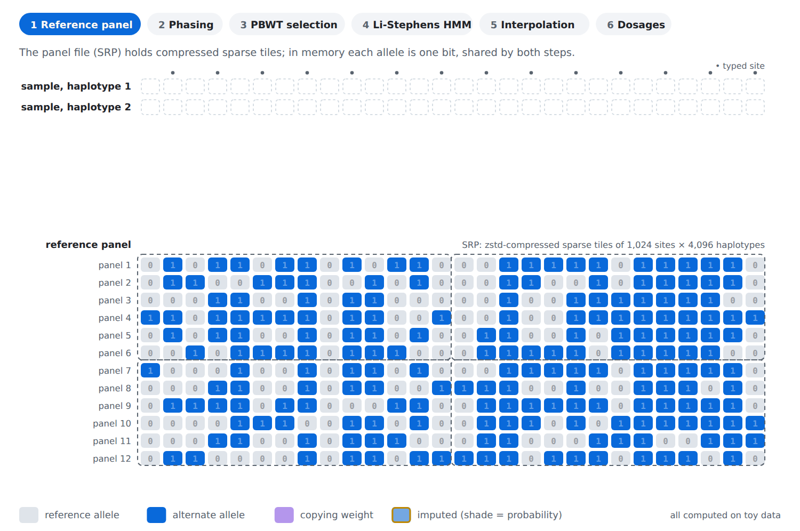

**2. Phasing.** Phasing: heterozygotes form segments of up to three (up to 2³ configurations); MCMC samples both paths against panel neighbours.

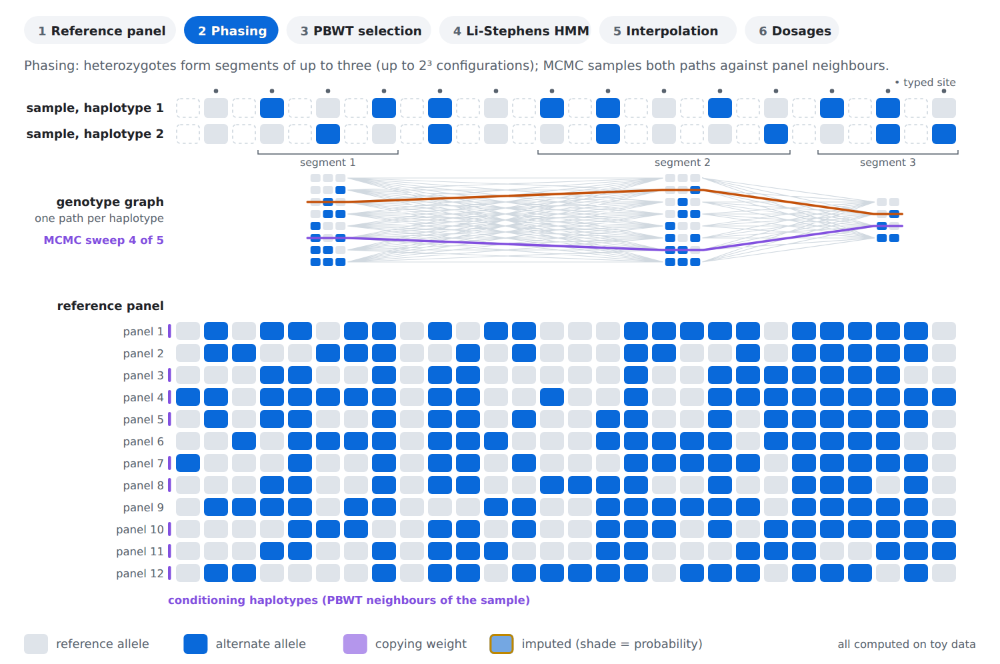

**3. PBWT selection.** PBWT: with the panel sorted by reversed prefixes, the haplotypes next to the target's place match it longest: the candidates.

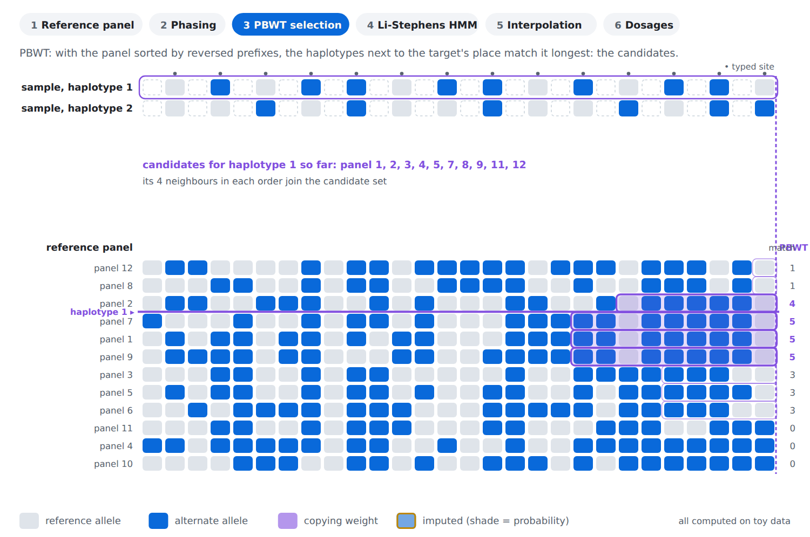

**4. Li-Stephens HMM.** A Li-Stephens HMM runs forward, then backward, over the typed sites: each candidate gets a copying weight.

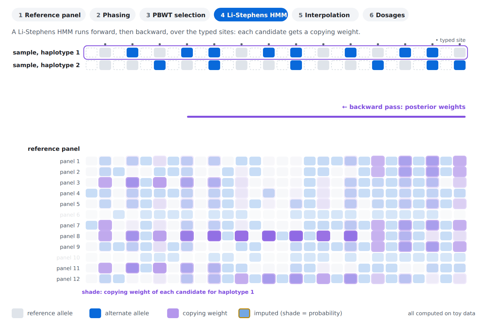

**5. Interpolation.** Untyped sites take the weights interpolated in cM from the typed sites around them; the allele probability is the weight on carriers.

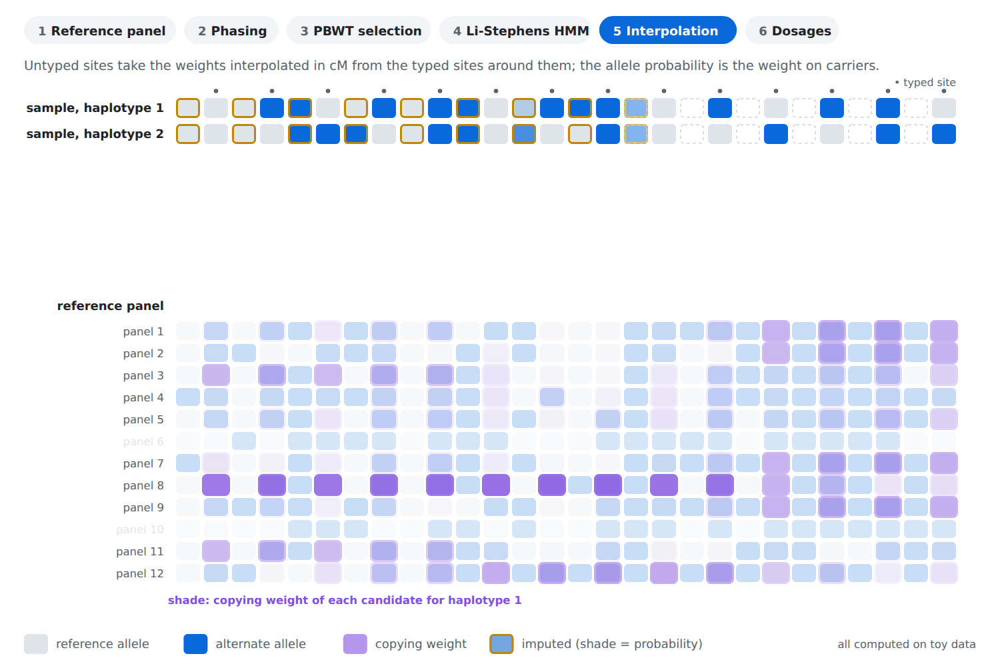

**6. Dosages.** DS = AP1 + AP2 per site, averaged over the phase ensemble, written with the most likely phased genotype.

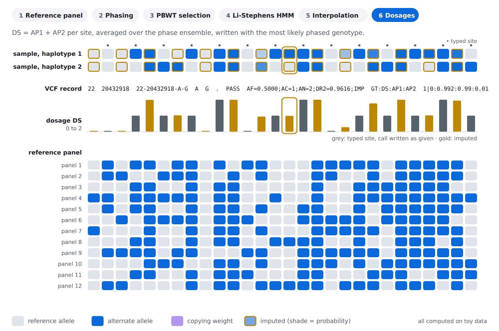

- [Installation](#installation)
- [Quick start](#quick-start)
- [Usage](#usage): [arrays and sequencing calls](#arrays-and-sequencing-calls) ·
  [low-coverage sequencing](#low-coverage-sequencing) · [whole genome](#whole-genome-in-one-run) ·
  [phasing only](#phasing-only) · [phased input](#phased-input) · [mixed confidence](#calls-of-mixed-confidence) ·
  [caller VCF with reads](#a-callers-vcf-with-the-reads) ·
  [exomes](#exomes-and-variant-only-vcfs) · [cohort phasing](#phasing-a-cohort-without-a-panel) ·
  [large cohorts](#large-cohorts) · [reference panels](#reference-panels) · [evaluation](#accuracy-evaluation)
- [Output](#output) · [Main options](#main-options) · [Performance](#performance) · [Citation](#citation) · [License](#license)

## Installation

Requires Rust 1.89 or newer and a C compiler (gcc or clang).

```bash
git clone -b new_version/selphi2_cluster https://github.com/omicsedge/selphi.git   # master holds Selphi 1
cd selphi
cargo build --release              # binary: target/release/selphi
cargo install --path .             # optional: put selphi on the PATH
```

Selphi builds on Linux and macOS, on x86_64 and aarch64 (Apple Silicon, AWS Graviton). x86_64 builds need a CPU
with AVX2 and FMA (Intel Haswell, AMD Zen or newer).
`scripts/build-release.sh` writes a Linux binary to `dist/` (`--musl` adds a static build for Alpine or scratch
containers, about 60% slower).

**Inputs you need.** A phased reference panel, a genetic map in PLINK format (one file per chromosome or one for
the whole genome; the [Beagle GRCh38 maps](https://bochet.gcc.biostat.washington.edu/beagle/genetic_maps/) work as
they are) and, for reads, the reference FASTA with its `.fai` index. All of them on the same genome build as the
target.

## Quick start

```bash
# 1. Convert the reference panel once (VCF.gz, BCF or BREF3): writes panel.chr22.srp next to it
selphi --prepare-reference-from panel.chr22.bcf --threads 16

# 2a. Array or sequencing genotypes (VCF/BCF, phased or not, one or many samples)
selphi --refpanel panel.chr22.srp --input samples.vcf.gz --map plink.chr22.GRCh38.map \
  --out imputed --threads 16

# 2b. Low-coverage sequencing, straight from the aligned reads
selphi --bam sample.bam --reference GRCh38.fa --refpanel panel.chr22.srp \
  --map plink.chr22.GRCh38.map --out imputed --threads 16
```

No other option is needed: Selphi reads the input, chooses the engine and the phasing settings, and says in the log
what it chose. The result is `imputed.vcf.gz` with its index. Three real runs, replayed from their logs:

```text
$ selphi --refpanel chr22.srp --input chip.vcf.gz --map chr22.map --out imputed \
    --truth truth.vcf.gz --exclude-panel-monomorphic chr22.srp --threads 16
Script started on 2026-11-10 16:21:34+00:00 [COMMAND="selphi --refpanel chr22.srp --input chip.vcf.gz --map chr22.map --out imputed --truth truth.vcf.gz --exclude-panel-monomorphic chr22.srp --threads 16 " <not executed on terminal>]
[selphi] SIMD: AVX-512F+DQ
  auto-route: sniff GT=true PL=false GQ=false DP=false call-rate=1.000 (of 1602000 GT entries) density=262/Mb (thr 1000) settled PL 0/0 (variant records 0/0, blocks 0) [0.0s | 108 MB]
  auto-route: confident hard calls (GT-only, or GQ/DP below WGS density) → genotype engine (no refine) [0.0s | 108 MB]

  ___ ___ _    ___ _  _ ___
 / __| __| |  | _ \ || |_ _|
 \__ \ _|| |__|  _/ __ || |
 |___/___|____|_| |_||_|___|
      v2.0.0 🦀 SelfDecode™

  input:    chip.vcf.gz
  refpanel: chr22.srp
  map:      chr22.map
  output:   imputed
  threads:  16
  log:      imputed.log

  Loaded SRP: 1070401 variants, 4802 haplotypes                [0.1s | 180 MB]
  Target: 801 samples, 9283 variants, phased=false             [0.2s | 181 MB]
  Variant intersection: 9283 hash matches, 0 plain matches
  Shared markers: 9283 (100.0% of target)                      [0.2s | 181 MB]
  Auto max_candidates: n_ref=4802, chunk_cv=0.691, scale=0.652 → mc=4802 (clamp [2500..1000000]) [0.3s | 212 MB]
  Resources: 9.2 GB estimated, 123.1 GB system RAM, 16 threads (mc=4802)
  Input is unphased — running phasing pipeline...              [0.3s | 242 MB]
  Phasing replicas on: each of the 801 sample(s) phased as 2 copies banned from each other, dosages averaged over all copies' members (default for an unphased cohort above 8 samples: two copies of one member each (SELPHI_DIPLOID_REPLICAS_COHORT_MAX caps it); SELPHI_DIPLOID_REPLICAS=1 turns it off) [0.3s | 242 MB]
  Ref bitmatrix extracted (9283 target sites × 4802 haps, 5.6 MB) [0.3s | 292 MB]
  Using Diploid phasing                                        [0.3s | 292 MB]
  Common ref subset (9037 / 9283 variants, 5.5 MB)             [0.3s | 292 MB]
  Diploid phasing of 2 copies of each sample, 1 member(s) each: 2 ensemble members (1× phasing of 1602 samples) [0.3s | 292 MB]
  Ancestry phase check (293 labelled panel samples per group): 0 of 801 sample(s) corrected [23.4s | 698 MB]
  Phasing complete: 801 samples phased                         [23.4s | 698 MB]
  Diploid intra-run ensemble: averaging 2 members from 2 co-phased replicas [23.4s | 698 MB]
  Genetic map loaded + LD correction                           [23.4s | 698 MB]
  formats:  VCF.gz
  PBWT sort shared across 16 targets (101 groups on 16 threads; auto: 121 GB available, 8.5 MB per in-flight target -> +2.0 GB; mc/n_ref 1.00). Byte-identical; set SELPHI_PBWT_SHARE=1 to disable.
    Window 1/2: PBWT=17.2s interp=6.0s (5222 vars)
    Window 2/2: PBWT=12.4s interp=3.2s (4301 vars)
  Output: imputed.vcf.gz  (1,070,401 variants × 801 samples · 551.4 MB) [62.4s | 6769 MB]
  Imputation quality: mean DR2 0.3329 · 18.3% of 1,061,118 imputed variants DR2 ≥ 0.8 · mean genotype confidence 0.9902 · 97.2% of calls ≥ 0.9
  Evaluating accuracy vs truth...                              [62.4s | 6769 MB]
  dosage:   diploid-equivalent R²/concordance; original-copy truth AF
  DS units: imputed=InputDosageOptions { ds_scale: Native, fallback_ploidy: None }, truth/raw=InputDosageOptions { ds_scale: Native, fallback_ploidy: None }
  imputed:  imputed.vcf.gz
  truth:    truth.vcf.gz
  shared:   801 samples
  GT scan:  reference call (all alleles 0) in data record 1 → complete callset
  exclude:  54076 of 1070401 panel sites monomorphic in chr22.srp (54076 new)
  Building TBI index in memory for parallel eval: truth.vcf.gz

MAF bin                N variants    Mean R²  Concordance
------------------------------------------------------------
0.05-0.1%                  138764     0.2897       0.9988
0.1-0.2%                   117614     0.3422       0.9976
0.2-0.5%                   110884     0.4373       0.9953
0.5-1%                      62388     0.5180       0.9914
1-2%                        45155     0.5808       0.9853
2-5%                        45267     0.6821       0.9756
5-10%                       28734     0.7639       0.9600
10-20%                      31518     0.7996       0.9368
20-50%                      59501     0.8448       0.9168
------------------------------------------------------------
OVERALL                   1016325     0.4935       0.9887
  (OVERALL mean R² over 639825 site(s) in the MAF bins; concordance over 1016325 site(s) with a scored sample)

Per-sample (n=801):
  R²:          mean=0.918174, min=0.828297, max=0.946577
  Concordance: mean=0.988741

  Imputed:  1070401 variants
  Truth:    1070401 variants
  Matched:  1016325 variants (94.9% of truth)
  Chromosomes: 1 (22)
  Accuracy: imputed.eval.json                                  [69.0s | 6769 MB]

Total: 69s | Peak memory: 6769 MB

Script done on 2026-11-10 16:22:43+00:00 [COMMAND_EXIT_CODE="0"]
```

```text
$ selphi --refpanel chr22.srp --input wgs.vcf.gz --map chr22.map \
    --out phased --phase-only --threads 16
Script started on 2026-11-04 07:57:57+00:00 [COMMAND="selphi --refpanel chr22.srp --input wgs.vcf.gz --map chr22.map --out phased --phase-only --threads 16 " <not executed on terminal>]
[selphi] SIMD: AVX-512F+DQ
  auto-route: sniff GT=true PL=false GQ=false DP=false call-rate=1.000 (of 108000 GT entries) density=26022/Mb (thr 1000) settled PL 0/0 (variant records 0/0, blocks 0) [0.0s | 627 MB]
  auto-route: confident hard calls (GT-only, or GQ/DP below WGS density) → genotype engine (no refine) [0.0s | 627 MB]

  ___ ___ _    ___ _  _ ___
 / __| __| |  | _ \ || |_ _|
 \__ \ _|| |__|  _/ __ || |
 |___/___|____|_| |_||_|___|
      v2.0.0 🦀 SelfDecode™

  input:    wgs.vcf.gz
  refpanel: chr22.srp
  map:      chr22.map
  output:   phased
  threads:  16
  log:      phased.log

  Loaded SRP: 1070401 variants, 4478 haplotypes                [0.1s | 627 MB]
  Target: 54 samples, 1070401 variants, phased=false           [0.9s | 651 MB]
  Variant intersection: 1070399 hash matches, 0 plain matches
  Shared markers: 1070399 (100.0% of target)                   [1.0s | 651 MB]
  Target sites absent from the panel: 2 written as given       [1.9s | 651 MB]
  Auto max_candidates: n_ref=4478, chunk_cv=0.817, scale=0.753 → mc=4478 (clamp [2500..1000000]) [2.0s | 973 MB]
  Resources: 6.8 GB estimated, 123.1 GB system RAM, 16 threads (mc=4478)
  Input is unphased — running phasing pipeline...              [2.1s | 995 MB]
  Ref bitmatrix extracted (1070399 target sites × 4478 haps, 599.4 MB) [2.3s | 1291 MB]
  Using Diploid phasing                                        [2.3s | 1291 MB]
  Private-het routing: 16787 panel-absent singleton sites left to phase_rare (686 kept in the scaffold: position shared with another record) [2.3s | 1291 MB]
  Common ref subset (560653 / 1070399 variants, 314.0 MB)      [2.3s | 1572 MB]
  Ancestry phase check, sequencing density: 7240 markers among the scaffold sites (275 labelled panel samples per group) [2.3s | 1571 MB]
  Phase-only: panel kept at the 16787 rare sites (9.4 MB), chip-site matrix released [2.4s | 1577 MB]
  Ancestry phase check (275 labelled panel samples per group): 0 of 54 sample(s) corrected [65.9s | 4827 MB]
  Phasing complete: 54 samples phased                          [65.9s | 4827 MB]
  Phase-only VCF: phased.vcf.gz                                [66.8s | 4827 MB]

Total: 67s | Peak memory: 4827 MB

Script done on 2026-11-04 07:59:04+00:00 [COMMAND_EXIT_CODE="0"]
```

```text
$ selphi --refpanel chr22.srp --bam HG002.bam --reference GRCh38.fa \
    --map chr22.map --out lowcov --threads 16
Script started on 2026-11-04 07:59:04+00:00 [COMMAND="selphi --refpanel chr22.srp --bam HG002.bam --reference GRCh38.fa --map chr22.map --out lowcov --threads 16 " <not executed on terminal>]
[selphi] SIMD: AVX-512F+DQ
  auto-route: aligned reads (BAM/CRAM) → lcWGS engine [0.0s | 43 MB]

  ___ ___ _    ___ _  _ ___
 / __| __| |  | _ \ || |_ _|
 \__ \ _|| |__|  _/ __ || |
 |___/___|____|_| |_||_|___|
      v2.0.0 🦀 SelfDecode™

  mode:     lcwgs
  input:    HG002.bam
  refpanel: chr22.srp
  map:      chr22.map
  output:   lowcov
  threads:  16
  log:      lowcov.log

  SRP loaded: 964078 variants, 6332 haps                       [0.1s | 131 MB]
  lcWGS-BAM: 1 BAM(s), chrom chr22, 964078 panel sites (964078 SNPs, 0 indels)
  lcWGS read-pair linkage: forward-backward and phaser at sites of panel MAF >= 0.01 (minor-allele bases below), the first 8 bases of a site of at most 3, samples of median depth <= 3 (LCWGS_LINKAGE=0: off)
  lcWGS-BAM: BAQ on (extended, partial-realignment heuristic — bcftools mpileup default); reference window 50818468 bp
  lcWGS-BAM: HG002: 246215 reads, 6894 triggering sites, 7067 realigned (2.9%), 0 BAQ no-ops [0.7s | 1215 MB]
  lcWGS read-pair linkage: HG002: 118235 read pairs over >= 2 SNP sites, median depth 1
  lcWGS panel of 6332 haplotypes (< 30311): conditioning capped in GLIMPSE2 rank order (g2) at kpbwt 2000, no rare-carrier augmentation, 2 Gibbs chain(s) of 20 iterations (15 main) averaged; LCWGS_SMALL_PANEL=old restores the previous conditioning [1.3s | 1215 MB]
  chunked Gibbs: 82.4 cM span → 6 chunks (core 16.0 cM + 0.5 cM buffer each side) [1.3s | 1215 MB]
  lcWGS process memory allowance: 5.41 GB (shared/cache 1.33 GB)
  lcWGS read-pair linkage: 2537982 forward-backward anchor entries (2537978 drawn jointly, 4 left to per-site draws); phaser potentials on 61056 segments and 50502 boundaries, 3635 read pairs over more than two segments (Metropolis-Hastings: 221 accepted, 7 rejected)
  lcwgs done: 964078 variants × 1 sample                       [14.3s | 2472 MB]
  Imputation quality: mean GP confidence 0.9985  ·  99.6% of 964,078 calls ≥ 0.9
  wrote imputed VCF: lowcov.vcf.gz                             [14.6s | 2472 MB]
  wrote dosage TSV: lowcov.dose.tsv.gz                         [14.7s | 2472 MB]

Total: 15s | Peak memory: 2472 MB

Script done on 2026-11-04 07:59:19+00:00 [COMMAND_EXIT_CODE="0"]
```

## Usage

### Arrays and sequencing calls

```bash
selphi --refpanel panel.chr22.srp --input samples.vcf.gz --map chr22.map --out imputed --threads 16
```

- Input is VCF or BCF, phased or unphased. Selphi phases the samples, then imputes every panel site.
- Bases are matched in any case (`C>CaAT` is the panel site `C>CAAT`) and written upper case.
- Multi-allelic records are split. A substitution with REF and ALT swapped against the panel is matched (not a
  palindromic A/T or C/G SNP); `--allele-match full` also matches strand flips.
- Records the panel does not have are written back with their genotype calls (`--drop-unmatched` leaves them out).
- Missing genotypes (`./.`) are imputed. A call whose FILTER is not `PASS` is read as missing
  (`--input-filter keep` reads it as given).
- A sequencing VCF with likelihoods (`PL`) may be routed to the low-coverage engine, as the log says;
  `--engine genotype` keeps it on this one.
- chrX: men are recognised from their genotypes. Give the whole chrX map: `plink.chrX_par1` and `_par2` files next
  to the chrX map are joined automatically. chrY and MT are not imputed.

### Low-coverage sequencing

For genomes sequenced at about 0.5-4x. Selphi computes genotype likelihoods from the reads at the panel sites and
combines them with the panel: where the reads are sharp they carry the call, where they are thin or absent the panel
does. Each output genotype is the most probable one.

**1. Reads.** Low-coverage reads (about 1.5x here): most sites are seen by one or two reads, some by none. A read pair comes from one haplotype.

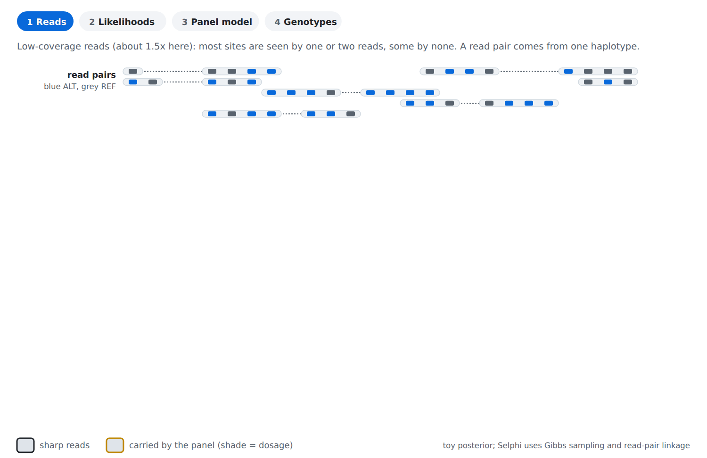

**2. Likelihoods.** Each site gets genotype likelihoods from its reads: sharp where several reads agree, flat where there are none.

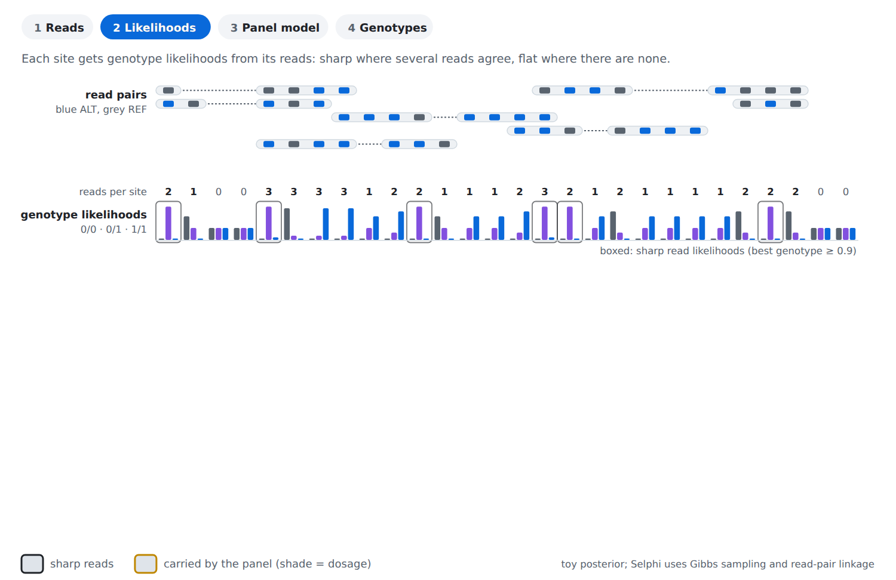

**3. Panel model.** The panel supplies what the reads lack: the sample's two haplotypes are modelled as copies of panel haplotypes.

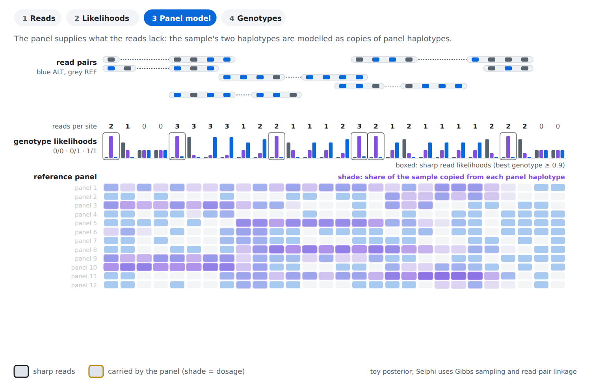

**4. Genotypes.** Likelihood × panel model at every site: where the reads are sharp they carry the call; elsewhere the panel does.

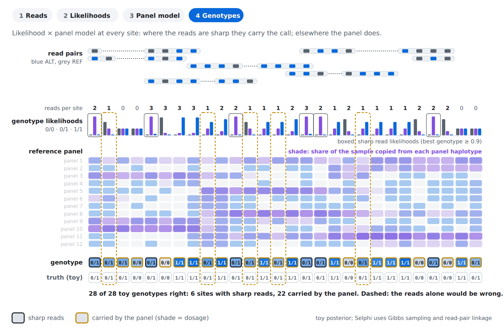

```bash
selphi --bam sample.cram --reference GRCh38.fa --refpanel panel.chr22.srp --map chr22.map --out imputed --threads 16
selphi --bam-list bams.txt --reference GRCh38.fa --refpanel panel.chr22.srp --map chr22.map --out imputed   # one path per line
selphi --input sample.pl.vcf.gz --refpanel panel.chr22.srp --map chr22.map --out imputed                   # a VCF/BCF with PL
```

Pass `--reference` for BAM files too: CRAM needs it, and for BAM it enables base alignment quality as in
`bcftools mpileup`. With reads, `--region chr22:20000000-30000000` limits the run to a region. The output is
`imputed.vcf.gz` (unphased `GT`, `DS`, `GP`) and `imputed.dose.tsv.gz`.

### Whole genome in one run

```bash
selphi --prepare-reference-from panels/ --out all_chromosomes --threads 16     # a folder of per-chromosome BCFs
selphi --refpanel all_chromosomes.srp --input genome.vcf.gz --map-dir maps/ --out imputed --threads 16
```

The chromosomes run one after the other into one VCF.gz (or BCF with `--bcf`). The same works with `--bam`, which
writes a VCF.gz and a dosage table. `--map` also accepts one genome-wide map.

### Phasing only

```bash
selphi --refpanel panel.chr22.srp --input samples.vcf.gz --map chr22.map --out phased --phase-only
```

Writes `phased.vcf.gz`. Needs genotype calls and a single-chromosome panel. An input that is already phased gives
no output unless `--force-phasing` is added.

### Phased input

By default a phased input is phased again, and each sample whose given phase agrees well overall with the new
one keeps it as one of the two phasings the imputation averages over.

| Option | Effect |
|---|---|
| `--keep-input-phase` | impute on the given phase, without phasing (faster) |
| `--trust-input-phase` | always keep each sample's given phase as one of the two |
| `--force-phasing` | phase again and ignore the given phase |

### Calls of mixed confidence

A sequencing VCF can say how sure each call is (`PL`, `GL`, `GQ`, `DP`). `--engine auto` picks one of three routes
from the file and the panel, and the log says which:

- **likelihoods** (most sequencing-density files with `PL`, `GL` or `GQ`): each genotype comes from the call's
  likelihood and the panel together, so sharp calls carry their site and weak or missing ones are decided by the
  panel. The output is that of [low-coverage data](#low-coverage-sequencing).
- **genotype + refine** (other sequencing-density files with `GQ` or `DP`, single-chromosome panel): calls at or
  above the confidence threshold are kept as given; the others, and missing calls, get imputed dosages.
- **genotype** (lower density, such as arrays): calls are kept as given and missing ones are imputed.

### A caller's VCF with the reads

For a ~30x genome with its variant caller's VCF: Selphi writes the caller's file back, with its own genotypes
where the caller has no variant call and the read depth (base and mapping quality 20) is below 20 (`--calls-depth`).

```bash
selphi --bam HG002.cram --reference GRCh38.fa --refpanel panel.chr22.srp --map chr22.map \
  --calls HG002.deepvariant.vcf.gz --out HG002.merged --threads 16
```

One sample per run; add `--calls-gvcf` when the calls are a gVCF. The output is one VCF.gz with its index.

### Exomes and variant-only VCFs

A single deep genome whose VCF lists only its variant sites is recognised: the panel sites it leaves out within
the span of its records are read as reference calls (flagged `IMP` in the output); long gaps are imputed. For an
exome or a targeted panel, give the regions the caller covered with `--callable targets.bed`. gVCF reference blocks
are read as reference calls.

### Phasing a cohort without a panel

```bash
selphi --phase-panel --input cohort.vcf.gz --map chr22.map --out panel --srp --threads 16
```

Phases a cohort against itself and writes `panel.vcf.gz`; `--srp` and `--bref3` also write it as a reference panel.
An indexed BCF of 16,000 or more samples is read in chunks; `--region chr22:16000000-20000000` phases one region
(in memory).

### Large cohorts

`--sample-batch-size 100` imputes the samples 100 at a time, which bounds the memory of the imputation (reading
and phasing still see the whole cohort). Batching averages over one phasing instead of two, so dosages differ
slightly from an unbatched run. Temporary files go to `$TMPDIR` (default `/tmp`).

### Reference panels

```bash
selphi --prepare-reference-from panel.chr22.bcf --threads 16           # BCF (with .csi), VCF.gz or BREF3 -> .srp
selphi --merge-srps-dir srps/ --out all_chromosomes                    # per-chromosome .srp -> one file
selphi --prepare-reference-from panel.srp --out panel.bcf --threads 16  # .srp or .bref3 -> BCF or VCF.gz
```

A BCF is read in parallel with constant memory; a VCF.gz is loaded into memory first.

### Accuracy evaluation

```bash
selphi --refpanel panel.chr22.srp --input array.vcf.gz --map chr22.map --out imputed --truth truth.vcf.gz
selphi --evaluate imputed.vcf.gz --truth truth.vcf.gz --out eval
```

Reports R² and concordance per site and per sample, by minor allele frequency, as text and JSON. Useful options:
`--exclude-sites array.vcf.gz` (score imputed sites only), `--exclude-panel-monomorphic panel.srp`,
`--homref-absent on` (sites absent from the truth count as reference), `--by-type` (SNPs and indels apart).
Low-coverage output is scored with `--evaluate`.

`selphi --index file.vcf.gz` builds a `.tbi` (`.csi` for a BCF). After building, `selphi --self-test` checks every
output path on a small single-chromosome panel:

```bash
selphi --self-test --refpanel panel.chr22.srp --input target.vcf.gz --map chr22.map --out selftest --truth truth.vcf.gz
```

## Output

| Option | Format | Per sample |
|---|---|---|
| *(default)* | VCF.gz + `.tbi` | `GT`, `DS`, `AP1`, `AP2` |
| `--bcf` | BCF, instead of VCF.gz | `GT`, `DS`, `AP1`, `AP2` |
| `--parquet` | Apache Parquet | `DS` |
| `--pgen` | PLINK 2 PGEN | hard call and dosage |
| `--selfdecode` | ZIP of per-sample Parquet | `GT`, `AP1`, `AP2` |

These formats are for the array and sequencing-call engine; they can be combined in one run and carry the same
dosages, up to each format's precision. Parquet, PGEN and SelfDecode need a single-chromosome run. Low-coverage
runs write a VCF.gz (`GT`, `DS`, `GP`) and a dosage table.

| Field | Meaning |
|---|---|
| `GT` | genotype: phased, except in low-coverage output |
| `DS` | dosage: expected number of ALT alleles (0-2) |
| `AP1`, `AP2` | probability of the ALT allele on haplotype 1 and 2 (`--no-ap` leaves them out) |
| `GP` | genotype probabilities (low-coverage runs; with `--gp` for the others) |
| `INFO/DR2` | estimated imputation accuracy of the site |
| `INFO/IMP` | the site was not in the input |

Sites typed in the input keep their calls and carry `GT` only; a missing call there is imputed.

## Main options

| Option | Meaning |
|---|---|
| `--refpanel FILE` | reference panel (`.srp`) |
| `--input FILE` / `--bam FILE` | target genotypes (VCF/BCF) or aligned reads (BAM/CRAM) |
| `--map FILE` / `--map-dir DIR` | genetic map(s), PLINK format |
| `--out PREFIX` | output prefix |
| `--threads N` | threads (default: all) |
| `--reference FASTA` | reference genome, for CRAM and read input |
| `--phase-only` | phase without imputing |
| `--bcf`, `--parquet`, `--pgen`, `--selfdecode` | output formats |
| `--truth FILE` | score the result against true genotypes |
| `--seed N` | random seed for phasing (default 33) |

`selphi --help` lists the other options.

## Performance

<p align="center">
  <picture>
    <source media="(prefers-color-scheme: dark)" srcset="../img/speed_dark.svg"/>
    <source media="(prefers-color-scheme: light)" srcset="../img/speed_light.svg"/>
    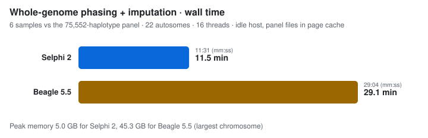
  </picture>
</p>

<p align="center">
  <picture>
    <source media="(prefers-color-scheme: dark)" srcset="../img/lcwgs_dark.svg"/>
    <source media="(prefers-color-scheme: light)" srcset="../img/lcwgs_light.svg"/>
    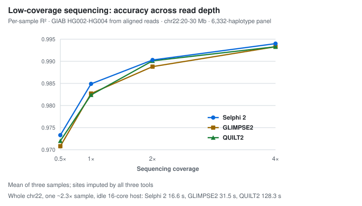
  </picture>
</p>

Methods, parameters and the full benchmarks (accuracy by allele frequency, phasing switch error, other panels and
tools) are in the Selphi 2 manuscript, in preparation.

## Citation

```
Selphi, a tool for improving genotype imputation accuracy
Adriano De Marino, Abdallah Amr Mahmoud, Sandra Bohn, Jon Lerga-Jaso, Biljana Novković,
Charlie Manson, Salvatore Loguercio, Andrew Terpolovsky, Mykyta Matushyn, Ali Torkamani, Puya G. Yazdi
Scientific Reports 16, 28051 (2026); doi: https://doi.org/10.1038/s41598-026-58420-2
```

## License

This software is provided free of charge for **academic research use only**. Any use by **commercial entities,
for-profit organizations, or consultants** is strictly prohibited without prior authorization. For inquiries about
commercial licensing, contact **pyazdi@gmail.com**. Full terms in [LICENSE](../LICENSE); code adapted from
other projects keeps its own licence terms, listed in [NOTICE](../NOTICE).
